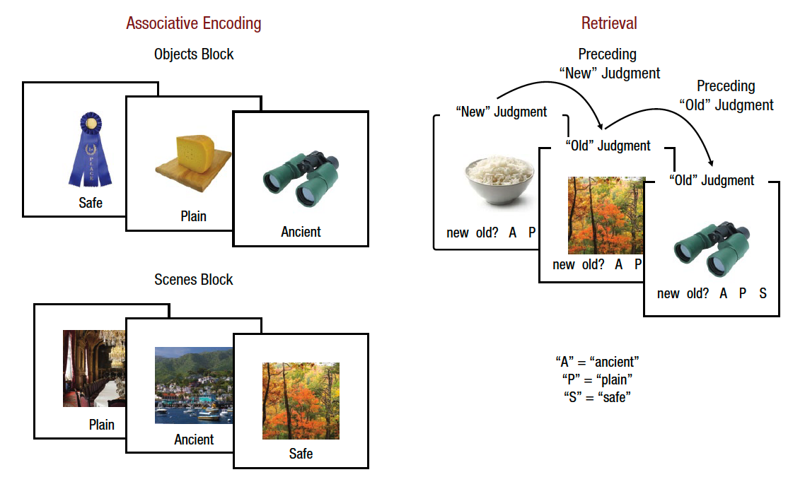

```{=html}
<!--
PSYCH 251 replication report template.

Every project uses this structure so that reports are comparable across the class. They
become public supplementary material, so write for a reader who has the original paper but
not your repository.

The project has two phases, and so does this report:
  Phase 1, the replication. Introduction and Methods are written, critiqued and preregistered
           BEFORE data collection; the Methods addendum, Results and Discussion after it.
  Phase 2, the extension. Proposed after Phase 1 (Rationale, Changes from Phase 1, Power and
           sample, Analysis plan), then run, with its own Results and Discussion.
The AI use statement and the Key statistics table sit at the top and are kept current
throughout. Follow the Extension guidelines page on Canvas for Phase 2.

Render this file at every stage. Before a phase has data, its results say so and skip
themselves; during Pilot A the Phase 1 results run on pilot data, which is the point of Pilot A.

Grey "Guidance" boxes are instructions. Delete each one once you have written that section.
The code is wired to the template's demo experiment (the framing problem). Replace the demo
specifics with your study's as you go: the experiment ids, the original study's numbers, the
exclusion rule, and the key comparison.
-->
```

```{r}
#| label: setup
#| include: false
library(tidyverse)
library(jsonlite)

# Must match EXPERIMENT.id in experiment.js, and the --experiment you passed to the export.
# Phase 2 runs under its own id, so its data never mix with Phase 1's.
experiment_id        <- "patil2018-pilot-b"
experiment_id_phase2 <- "patil2018-phase2"

# Minimum test trials for a session to be analysed. A full session has 484 (242 scenes + 242
# objects). Lower it only to analyse shortened ?n= test runs on localhost.
min_test_trials <- 484

# Tab-switch rule (Analysis plan): exclude participants with more than this proportion of
# test trials affected by the trial-level tab-switch rule.
max_tab_trial_prop <- 0.10

# Phase 1 data collection began on this date. Pilot B ran under the same EXPERIMENT.id
# (patil2018-pilot-b) on 2026-10-28, so sessions started before this date are left out.
phase1_start <- as.POSIXct("2026-11-01", tz = "UTC")
```

```{r}
#| label: original-study
#| include: false
# The original study's numbers, entered once and used by the power analysis, the Key
# statistics table, and the side-by-side figures. Replace these with your original study's
# values, and say in a comment exactly where in the paper each one comes from.
#
# Patil & Duncan (2018), Experiment 1, N = 32 analysed (Method, p. 46).
# Results, p. 48: corrected associative-memory accuracy was 8.23 percentage points higher
# after an "old" judgment than after a "new" judgment on the preceding trial,
# 95% CI [4.10, 12.36], F(1, 31) = 13.88, p = .001, partial eta squared = .31.
original_n <- 32
original <- tibble(
  N        = original_n,
  estimate = 0.0823,   # old minus new, as a proportion
  ci_low   = 0.0410,
  ci_high  = 0.1236,
  F        = 13.88,
  df       = original_n - 1,
  p        = 0.001,
  pes      = 0.31
)

# Standardized paired effect for the power analysis: with 1 numerator df, F = t^2,
# so d_z = t / sqrt(N) = sqrt(F) / sqrt(N), about 0.66. (The reported CI implies a slightly
# larger t, about 4.1; the F is used because it is the test the paper reports.)
original_dz <- sqrt(original$F) / sqrt(original_n)

# Per-condition means for the side-by-side figure. The paper gives no table of means, so the
# "new" bar is read off Fig. 2a (p. 49, approximate) and the "old" bar is that plus the reported
# 8.23-point difference. Error bars in Fig. 2a are the SE of the difference between conditions
# (Morey, 2008); that SE is recovered here from the reported 95% CI: half-width / t(.975, 31).
original_se_diff <- (original$ci_high - original$ci_low) / 2 / qt(0.975, original_n - 1)
original_means <- tibble(
  prev_judgment = c("new", "old"),
  mean          = c(0.355, 0.355 + original$estimate),
  se            = original_se_diff,
  N             = original_n
)
```

::: {.callout-note appearance="simple" icon="false"}
## Project links

-   **Original paper:** Patil, A., Duncan, K. (2018). Lingering
    Cognitive States Shape Fundamental Mnemonic Abilities.
    *Psychological Science, 29*(1), 45–55
    <https://doi.org/10.1177/0956797617728592>
-   **Preregistration:** [OSF registration](https://osf.io/2guw4/overview)
    *(registered 2026-11-01, before final data collection)*
-   **Live experiment:** <https://psych251.github.io/patil2018/> (take
    the study exactly as participants did)
-   **Repository:** <https://github.com/psych251/patil2018> (experiment
    code, data, and this report)
:::

# AI use statement

I will use Claude Code to help with coding the experiments and for
revision of analysis code.

::: {.callout-tip icon="false"}
**Course policy: you write all of the text in this report yourself.** AI
tools may help with code, and may comment on drafts you have written,
but they may not write, rewrite or paraphrase any of the report's text.
That includes "polishing" a paragraph.

List every AI tool you used on this project, what you used it for, and
how you checked what it produced. Include coding assistants (for example
Claude Code, Codex, Copilot) and chat assistants. Name the model and
version where you know it. "How you checked" is the important column:
say what you verified yourself, not that the output "looked right". If
you used no AI tools, replace the table with a sentence saying so.
:::

| Tool and model | What it was used for | How you checked the output |
|------------------------|------------------------|------------------------|
| Claude Code (Claude Opus 5.5) | Implemented Experiment 1 in `experiment.js` from the paper's Method: encoding and retrieval timeline, timings, per-participant randomization and retrieval-sequence constraints, trial-level data fields, post-study questions. Added the jsPsych preload plugin. | Ran the study myself and checked the output data against the descriptions in the paper. |
| Claude Code (Claude Opus 5.5) | Added saving of the browser-interaction log (tab/window blur and focus) to the participant data | Checked the output data for the fields where browser interactions are saved. |
| Claude Code (Claude Opus 5.5) | Wrote the analysis code in this report: exclusion rule, corrected associative-memory accuracy, d′, the key statistic, the 2 × 2 repeated-measures ANOVAs, the side-by-side figure, and the pilot minimum-trials setting; fixed render errors | Read the code myself and made sure it was running the correct estimations. |
| Claude Code (Claude Opus 5.5) | Switched the study to Pilot B (`EXPERIMENT.id`, report `experiment_id`, `min_test_trials` back to 484) and added the preregistered tab-switch exclusions to the analysis code (`tab_flags()`, trial- and participant-level rules, exclusions table). Found and fixed a Caps Lock bug in the key lookups in `experiment.js` (with a test), and added `recode_keys()` to the report to rebuild the affected Pilot B participant's responses from the raw key presses. Added the `phase1_start` date filter that separates the Phase 1 sessions from Pilot B, which ran under the same experiment id | Check the raw data to confirm the bug and reviewed that the recovered data was correct |
| Claude Code (Claude Opus 5.5) | Added the exploratory fatigue analysis (`exploratory-fatigue` chunk): corrected associative accuracy and the preceding-judgment effect in the first vs second half of the test | Reviewed the code for appropriateness |
| Claude Code (Claude Opus 5.5) | Added the exploratory sensitivity analysis applying the proposed Phase 2 chance-level exclusion (one-sided Fisher's exact test, hit rate vs false-alarm rate) to Phase 1 (`exploratory-chance-exclusion` and `exploratory-chance-excluded` chunks) | Reviewed the code for appropriateness |

I wrote all of the text in this report myself. AI tools were not used to
write, rewrite or paraphrase it, and were not used to generate, alter,
or impute any participant data. I take full responsibility for the
content of this report, including any errors introduced by AI tools.

# Key statistics

```{r}
#| label: analysis-functions
#| code-summary: "Show the analysis code (shared by Phase 1 and Phase 2)"

# Rebuild the key-derived fields from the raw key press, with the same rules as experiment.js.
# Sessions run before the Caps Lock fix recorded "D" instead of "d", and the experiment's key
# lookup was case-sensitive, so those trials were saved with no response_label, every
# judgment "old", vividness 0, and wrong prev_* fields. Recoding here recovers them and leaves
# all other sessions unchanged.
retrieval_keys <- c(d = "new", f = "skip", j = "ancient", k = "plain", l = "safe")
vividness_keys <- c("h", "j", "k", "l")
recode_keys <- function(trials) {
  trials <- trials |>
    mutate(across(any_of(c("timed_out", "is_old", "item_correct", "assoc_correct", "prev_is_old")),
                  as.logical))
  if (!"retrieval" %in% trials$task) return(trials)
  key <- tolower(trials$response)
  trials <- trials |>
    mutate(vividness_rating = if_else(task == "vividness" & !timed_out,
                                      match(key, vividness_keys), vividness_rating))
  ret <- trials |>
    filter(task == "retrieval") |>
    mutate(response_label = if_else(timed_out, NA_character_, unname(retrieval_keys[tolower(response)])),
           judgment       = if_else(timed_out, NA_character_, if_else(response_label == "new", "new", "old")),
           item_correct   = if_else(timed_out, NA, (judgment == "old") == is_old),
           assoc_correct  = if_else(is_old & judgment %in% "old", response_label == studied_word, NA)) |>
    arrange(participant_id, trial_index) |>
    group_by(participant_id, retrieval_block) |>
    mutate(first = trial_in_block == 1,
           prev_judgment       = if_else(first, NA_character_, lag(judgment)),
           prev_response_label = if_else(first, NA_character_, lag(response_label)),
           prev_is_old         = if_else(first, NA, lag(is_old)),
           prev_rt             = if_else(first, NA_real_, lag(as.numeric(rt)))) |>
    ungroup() |>
    select(-first)
  bind_rows(filter(trials, task != "retrieval"), ret) |>
    arrange(participant_id, trial_index)
}

# Trial-level tab-switch flags from each participant's interaction log (blur/focus events,
# each tagged with the jsPsych trial_index it happened in). The participant counts as away
# from the trial with a blur through the trial with the next focus (or the end, if no focus
# follows). A test trial is
#   - tab_switch:   if its trial_index falls inside an away span,
#   - tab_excluded: if it, or the previous test trial in the same block, is tab_switch.
# Fixation/ISI screens have their own trial_index, so being away only during an ISI does not
# flag the test trials around it.
tab_flags <- function(participants, trials) {
  logs <- if ("interaction_data" %in% names(participants)) participants else
    mutate(participants, interaction_data = NA_character_)
  spans <- logs |>
    filter(!is.na(interaction_data)) |>
    transmute(participant_id, ev = map(interaction_data, ~ as_tibble(fromJSON(.x)))) |>
    unnest(ev) |>
    filter(event %in% c("blur", "focus")) |>
    arrange(participant_id, time) |>
    group_by(participant_id) |>
    mutate(span = cumsum(event == "blur")) |>
    filter(span > 0) |>
    group_by(participant_id, span) |>
    summarise(from = first(trial[event == "blur"]),
              to   = if (any(event == "focus")) first(trial[event == "focus"]) else Inf,
              .groups = "drop")
  trials |>
    filter(task == "retrieval") |>
    select(participant_id, trial_index, retrieval_block) |>
    left_join(spans, by = "participant_id", relationship = "many-to-many") |>
    group_by(participant_id, trial_index, retrieval_block) |>
    summarise(tab_switch = any(!is.na(from) & trial_index >= from & trial_index <= to),
              .groups = "drop") |>
    arrange(participant_id, trial_index) |>
    group_by(participant_id, retrieval_block) |>
    mutate(tab_excluded = tab_switch | lag(tab_switch, default = FALSE)) |>
    ungroup() |>
    select(participant_id, trial_index, tab_switch, tab_excluded)
}

# Load one phase's exported data and apply the exclusion rule. Returns NULL if that phase
# has not been exported yet, which is how every section below knows to skip itself.
# `since`: keep only sessions started on or after this time (NULL keeps every session).
read_phase <- function(id, since = NULL) {
  dir <- file.path("..", "data", "raw", id)
  if (!all(file.exists(file.path(dir, c("participants.csv", "trials.csv"))))) return(NULL)
  participants <- read_csv(file.path(dir, "participants.csv"), show_col_types = FALSE)
  trials       <- read_csv(file.path(dir, "trials.csv"), show_col_types = FALSE)
  if (!is.null(since)) {
    participants <- participants |> filter(started_at >= since)
    trials       <- trials |> filter(participant_id %in% participants$participant_id)
  }
  errors_path  <- file.path(dir, "errors.csv")
  errors <- if (file.exists(errors_path)) read_csv(errors_path, show_col_types = FALSE) else tibble()
  trials <- recode_keys(trials)
  trials <- trials |>
    left_join(tab_flags(participants, trials), by = c("participant_id", "trial_index"))

  complete <- participants |> filter(completed)

  # Exclusion rule (participant level), following Patil & Duncan (2018), Exp. 1 (p. 46):
  #   - reported prior participation in a similar study ("Yes"; "Not sure" is kept),
  #   - reported drowsiness "Throughout most of the study",
  # plus two checks on the session itself:
  #   - fewer than `min_test_trials` test trials (set at the top; 484 = a full session),
  #   - no response to any test trial (what a device without a keyboard produces),
  # and the tab-switch rule from the Analysis plan (see tab_flags() above):
  #   - more than `max_tab_trial_prop` of test trials tab_excluded.
  post <- trials |>
    filter(task == "post_study") |>
    mutate(resp = map(response, ~ fromJSON(.x))) |>
    transmute(participant_id,
              prior_participation = map_chr(resp, ~ as.character(.x$prior_participation %||% NA)),
              drowsiness          = map_chr(resp, ~ as.character(.x$drowsiness %||% NA)))
  ret <- trials |>
    filter(task == "retrieval") |>
    group_by(participant_id) |>
    summarise(n_retrieval = n(),
              n_responded = sum(!as.logical(timed_out)),
              prop_tab    = mean(tab_excluded),
              .groups = "drop")
  checked <- complete |>
    left_join(ret, by = "participant_id") |>
    left_join(post, by = "participant_id") |>
    mutate(excl_short       = is.na(n_retrieval) | n_retrieval < min_test_trials,
           excl_no_response = !excl_short & n_responded == 0,
           excl_prior       = prior_participation %in% "Yes",
           excl_drowsy      = drowsiness %in% "Throughout most of the study",
           excl_tab         = coalesce(prop_tab > max_tab_trial_prop, FALSE),
           excluded         = excl_short | excl_no_response | excl_prior | excl_drowsy | excl_tab)
  keep <- checked |> filter(!excluded)

  list(participants = participants, trials = trials, errors = errors,
       complete = complete, checked = checked, keep = keep,
       n_no_response = sum(checked$excl_no_response))
}

# Per participant x preceding judgment x category: corrected associative-memory accuracy and
# d', computed as in Patil & Duncan (2018), Data analysis (pp. 47-48).
#   - Test trials only; timed-out trials and trials with no preceding judgment in the same
#     block (first trial after a break, or the previous trial timed out) are dropped.
#   - Response priming: trials whose correct word equals the previous response are removed.
#   - Tab switches: tab_excluded trials (see tab_flags()) are removed.
#   - Associative memory: old images called old. Corrected accuracy = p(correct word) -
#     p(wrong word) / 2. "Old, can't remember" (F) responses count in the denominator only.
#   - Item memory (d'): trials without a correct association. Hits = old images called old,
#     false alarms = new images called old, with the log-linear correction (add 0.5 to
#     counts and 1 to totals) so rates of 0 or 1 stay finite.
memory_words <- c("ancient", "plain", "safe")
memory_cells <- function(d) {
  t <- d$trials |>
    filter(task == "retrieval", participant_id %in% d$keep$participant_id) |>
    mutate(is_old = as.logical(is_old), timed_out = as.logical(timed_out)) |>
    filter(!timed_out, prev_judgment %in% c("old", "new")) |>
    filter(!coalesce(studied_word == prev_response_label, FALSE)) |>
    filter(!tab_excluded) |>
    mutate(assoc_hit = is_old & judgment == "old" & response_label == studied_word,
           assoc_fa  = is_old & judgment == "old" & response_label %in% memory_words &
                         response_label != studied_word)
  t |>
    group_by(participant_id, prev_judgment, category) |>
    summarise(n_assoc   = sum(is_old & judgment == "old"),
              assoc_acc = if (n_assoc > 0) (sum(assoc_hit) - sum(assoc_fa) / 2) / n_assoc else NA_real_,
              n_old     = sum(is_old & !assoc_hit),
              n_new     = sum(!is_old),
              hit_rate  = (sum(is_old & !assoc_hit & judgment == "old") + 0.5) / (n_old + 1),
              fa_rate   = (sum(!is_old & judgment == "old") + 0.5) / (n_new + 1),
              dprime    = qnorm(hit_rate) - qnorm(fa_rate),
              .groups = "drop")
}

# Each participant's accuracy after "old" and after "new" judgments, averaged over category.
# Only participants with every cell (2 judgments x 2 categories) are kept, as in the ANOVA.
by_participant <- function(cells, dv = "assoc_acc") {
  cells |>
    group_by(participant_id) |>
    filter(n() == 4, !any(is.na(.data[[dv]]))) |>
    group_by(participant_id, prev_judgment) |>
    summarise(value = mean(.data[[dv]]), .groups = "drop") |>
    pivot_wider(names_from = prev_judgment, values_from = value)
}

# The key statistic: mean old-minus-new difference in corrected associative accuracy, with a
# 95% CI and the paired t test. With one numerator df this is the main effect of preceding
# judgment in the 2 x 2 ANOVA (F = t^2), so it has the same columns as `original`.
# NULL when no participant has data in every cell.
diff_ci <- function(cells) {
  w <- by_participant(cells)
  if (nrow(w) == 0) return(NULL)
  diffs <- w$old - w$new
  N <- length(diffs)
  if (N < 2) {
    return(tibble(N = N, estimate = mean(diffs), ci_low = NA_real_, ci_high = NA_real_,
                  F = NA_real_, df = N - 1, p = NA_real_, pes = NA_real_))
  }
  tt <- t.test(diffs)
  F  <- unname(tt$statistic)^2
  tibble(N = N, estimate = mean(diffs), ci_low = tt$conf.int[1], ci_high = tt$conf.int[2],
         F = F, df = N - 1, p = tt$p.value, pes = F / (F + N - 1))
}

# Condition means for the figure, with the same error bar as Fig. 2a: the SE of the
# old-minus-new difference (Morey, 2008), drawn on both bars.
condition_means <- function(cells) {
  w <- by_participant(cells)
  if (nrow(w) == 0) return(NULL)
  se <- if (nrow(w) > 1) sd(w$old - w$new) / sqrt(nrow(w)) else NA_real_
  tibble(prev_judgment = c("new", "old"), mean = c(mean(w$new), mean(w$old)),
         se = se, N = nrow(w))
}

# Side-by-side figure: any number of studies on the same axes, in the order given. Each is
# a tibble from condition_means() (or `original_means`); NULL or empty studies are skipped.
comparison_plot <- function(...) {
  studies <- list(...)
  studies <- studies[!map_lgl(studies, ~ is.null(.x) || nrow(.x) == 0)]
  df <- imap_dfr(studies, ~ mutate(.x, Study = .y)) |>
    mutate(Study = factor(Study, levels = names(studies)),
           prev_judgment = factor(prev_judgment, levels = c("new", "old"),
                                  labels = c("\u201cNew\u201d", "\u201cOld\u201d")),
           label = sprintf("n = %d", N))
  fills <- setNames(c("grey55", "#1E6E76", "#B8792A")[seq_along(studies)], names(studies))
  dodge <- position_dodge(width = 0.8)
  ggplot(df, aes(x = prev_judgment, y = mean, fill = Study)) +
    geom_col(position = dodge, width = 0.75) +
    geom_errorbar(aes(ymin = mean - se, ymax = mean + se), position = dodge, width = 0.2,
                  na.rm = TRUE) +
    geom_text(aes(y = 0.02, label = label), position = dodge, vjust = 0, size = 3, colour = "white") +
    scale_y_continuous(limits = c(min(0, df$mean - df$se, na.rm = TRUE), 1)) +
    scale_fill_manual(values = fills) +
    labs(x = "Preceding judgment", y = "Corrected associative-memory accuracy", fill = NULL) +
    theme_minimal(base_size = 12) +
    theme(legend.position = "top")
}

phase1 <- read_phase(experiment_id, since = phase1_start)
phase2 <- read_phase(experiment_id_phase2)
have_data   <- !is.null(phase1)
have_phase2 <- !is.null(phase2)
```

```{r}
#| label: key-stats
#| echo: false
# Each row is a one-row tibble with the same columns as `original` (N, estimate, ci_low,
# ci_high, F, df, p, pes), from diff_ci() under Key statistics. Statistics that need at least
# two analysed participants show as a dash until there are two.
fmt_row <- function(study, r, have = FALSE) {
  if (is.null(r)) {
    return(tibble(Study = study, N = "",
                  `Effect (old − new)` = if (have) "not enough data yet" else "not yet collected",
                  `95% CI` = "", F = "", p = "", `ηp²` = ""))
  }
  dash <- function(x, txt) if (is.na(x)) "—" else txt
  tibble(Study = study, N = as.character(r$N),
         `Effect (old − new)` = sprintf("%.2f points", 100 * r$estimate),
         `95% CI` = dash(r$ci_low, sprintf("[%.2f, %.2f]", 100 * r$ci_low, 100 * r$ci_high)),
         F = dash(r$F, sprintf("F(1, %d) = %.2f", as.integer(r$df), r$F)),
         p = dash(r$p, format.pval(r$p, digits = 2, eps = 0.001)),
         `ηp²` = dash(r$pes, sprintf("%.2f", r$pes)))
}
bind_rows(
  fmt_row("Original", original),
  fmt_row("Phase 1: replication", if (have_data) diff_ci(memory_cells(phase1)), have_data),
  fmt_row("Phase 2: extension", if (have_phase2) diff_ci(memory_cells(phase2)), have_phase2)
) |>
  knitr::kable(align = "lrlllrr",
               caption = "Key comparison: corrected associative-memory accuracy after an \"old\" judgment minus after a \"new\" judgment on the preceding trial, in percentage points.")
```

# Phase 1: Replication

## Introduction

### Justification

In this paper, Patil and Duncan found that recent exposure to
familiarity selectively improved associative memory (Experiment 1), and
that this effect decayed over seconds (Experiment 2). During my PhD, I
plan to study the development of different memory subprocesses,
including pattern completion and separation, so this paper will help me
better understand how these processes are studied in adults, as well as
how this type of data is analyzed, for example, using a Signal Detection
Theory framework to assess memory accuracy.

### Procedure and Challenges

This replication involved creating two online experiments using the same
stimuli from the original paper, which the authors made available on the
Open Science Framework. The stimuli consisted of 484 images on a white
background. Unlike the original study, I collected data online through
Prolific. One challenge I faced was obtaining quality data from an
online sample, which required implementing features that prevented bots
from completing the task.

### Statistical tests

Separate 2 (preceding judgment: old vs. new) × 2 (stimulus: object vs.
scene) repeated measures analyses of variance (ANOVAs) were used to
analyze corrected associative-memory accuracy, response time on trials
on which associative memory was correct, and d′.Paired-samples t tests
(two-tailed) were used to examine simple effects. For pairwise
comparisons, t tests were conducted with Bonferroni correction. Two
generalized mixed-effects models were estimated with an unstructured
covariance matrix to control for response time on the preceding trial
and preceding trial type, respectively.

### Extension

I propose an extension with two differences: 

1. Added comprehension checks after the instructions to ensure that participants understand the task from the beginning. 

2. In order to exclude participants whose performance in the task is not better than chance, I will only include those whose hit rate is significantly higher than their false alarm rate. The difference will be determined using a one-sided Fisher test with a significant level of 0.05. The goal is to remove participants that tend to select "new" or "old" in most trials. 

## Methods

### Power analysis

The estimate reported in the paper is **F(1, 31) = 13.88**, and the
effect size is **ηp2 = 0.31**. I chose to maintain the original sample
size mainly due to budget constraints. This experiment takes around \~50
minutes to be completed, and I am planning to play \$10/h. Therefore,
increasing the sample size to reach half of the reported effect size
would require a budget outside of the scope of the class.

```{r}
#| label: power
# Within-participant design: the key test is a paired comparison (the 1-df main effect of
# preceding judgment), so power is for a paired t test at the original d_z.
power_rows <- map_dfr(c(0.80, 0.90, 0.95), function(pw) {
  n <- power.t.test(delta = original_dz, sd = 1, power = pw, sig.level = 0.05,
                    type = "paired")$n
  tibble(power = scales::percent(pw), n_total = ceiling(n))
})

# 2.5 times the original sample (Simonsohn, 2015). A single number now: the inline text
# below still indexes two frames (two_and_half[2] will show NA until it is rewritten).
two_and_half <- ceiling(2.5 * original_n)

knitr::kable(power_rows, col.names = c("Power", "N participants"),
             caption = sprintf(
               "Sample needed to detect the original effect (%.2f points, d_z = %.2f from F(1, %d) = %.2f), paired, two-sided alpha = .05.",
               100 * original$estimate, original_dz, original$df, original$F))
```

For comparison, 2.5 times the original sample would be
`r two_and_half[1]` in the gain frame and `r two_and_half[2]` in the
loss frame (`r sum(two_and_half)` in total).

### Planned sample

The planned sample size is: 35 adult participants (18 and older) who are
currently living in the US and are fluent in English.

### Materials

The stimuli will be the same as in the original experimental design:

*"Stimuli consisted of colored images of 242 natural indoor and outdoor
scenes and 242 common objects (484 images total), along with three words
(“ancient,” “plain,” “safe”)"*

The original stimuli were published in the OSF website: https://osf.io/d7w8a/overview, so they were downloaded and incorporated in the task code. 

### Procedure

The procedure will be close to the original experiment, with the main
difference that the current replication will be held online.

The total study is divided into

1.  Consent form
2.  Images preloading. Participant waits for a few seconds without
    taking action.
3.  Welcome page. Brief explanation of the study.
4.  Demographic information
5.  Experiment 5.1 Study phase 5.2 Retrieval phase
6.  Post study questions: strategy, drowsiness.
7.  Feedback: question about instructions clarity.
8.  Debrief.

The task takes \~50 minutes to complete.

The design and timing will follow the original paper:

"*The experiment consisted of an encoding session in which participants
associated each image with one of the three words and a retrieval test
that simultaneously assessed associative memory for the words and item
memory for the images.*

*Encoding session. During each trial in the encoding session, an
image-word pair was displayed on the screen for 3 s. Images were trial
unique, and each image was pseudo-randomly paired with one of the three
words, such that all three words appeared an equal number of times
across the experiment. Participants were asked to vividly imagine a
scenario in which the word could describe the image to encourage deep
processing of image-word pairs. After the pair disappeared, participants
had 1.5 s to rate the imagined scenario on a 4-point continuous scale on
the keyboard, using “h” (very vivid), “j,” “k,” and “l” (not vivid at
all). A fixation cross was presented at the center of the screen for 1 s
before each trial. A post study debriefing session revealed that all
participants’ memory encoding strategies were consistent with the
instructions. Participants were informed before the encoding session
that their memory would be assessed. The encoding session was split into
eight 3-min blocks. Half the blocks consisted of scene-word pairs, and
the remaining blocks consisted of object-word pairs. Scene and object
blocks were presented in a counterbalanced alternating order.*

*Retrieval session. During the memory test, we assessed participants’
item and associative memory simultaneously. Critically, we manipulated
whether participants made each memory decision after an unrelated
familiar or novel image. During each retrieval trial, an image was shown
on the screen for 2 s. Participants were asked to indicate whether the
image was new (by pressing the “d” key) or old, in which case they were
asked to recall the word associated with it in the encoding session (by
pressing the “j,” “k,” or “l” keys, which corresponded with “ancient,”
“plain,” and “safe,” respectively). They were asked to press the “f” key
if they thought that an image was old but were unable to recall the
associated word (associative skip). Note that these response options
allowed us to assess participants’ item and associative memory with a
single response. The response window was intentionally short, consistent
with past research (Duncan et al., 2012), so that (a) memory judgments
were made before the mnemonic processing bias from the preceding trial
dissipated and (b) the bias from the preceding trial would not be
overcome with sufficient processing time. A central fixation cross was
presented during a 1-s interstimulus interval (ISI).*

*The retrieval session was split into four 6-min blocks. Half of the
images presented during the memory test had been previously studied
during the encoding session, while the remaining were novel. Critically,
scene and object images alternated during the memory test. This reduced
the possibility of consecutive old images semantically priming each
other, because consecutive images always belonged to different stimulus
categories and were, thus, studied during different encoding blocks.
Stimulus presentation was predetermined such that no more than four new
stimuli appeared consecutively and the transition probability between
seeing old and new images was .50.*

{width="547"}

### Analysis plan

The planned exclusion criteria are:

-   Trials in which participants switched tabs (browser interactions).
-   Trials that were preceded by an excluded trial based on tab
    switches.
-   At the participant level, I will exclude participants with more than
    10% of test trials affected by the trial-level rule.

The main statistical test will be the same stated in the paper:
*"Separate 2 (preceding judgment: old vs. new) × 2 (stimulus: object vs.
scene) repeated measures analyses of variance (ANOVAs) were used to
analyze corrected associative-memory accuracy, response time on trials
on which associative memory was correct, and d′. Paired-samples t tests
(two-tailed) were used to examine simple effects."*

The analysis is aimed at revealing a main effect of preceding judgment
(old vs. new) on corrected associative memory accuracy. Specifically,
accuracy is expected to be higher when the preceding trial was
identified as old.

### Differences from the original study

| Aspect | Original study | This replication | Expected to matter? |
|------------------|------------------|------------------|------------------|
| Sample | College students from Toronto | Adults recruited on Prolific | Possibly. Framing effects have been found in both student and general samples, but their size varies across populations. |
| Setting | In lab experiment | Online, unsupervised, on the participant's own computer | Possibly. This is a long study that probably benefits from the controlled environment of a laboratory setting. |
| Wording | The exact wording is not available online | Based on the description given in the paper | Unlikely. The instructions are essentially the same |

### Methods addendum (post data collection)

#### Actual sample

```{r}
#| label: no-data-notice
#| echo: false
#| results: asis
if (!have_data) {
  cat(
    "::: {.callout-warning icon=false}\n",
    "## No Phase 1 data yet\n\n",
    "There are no exported data for `", experiment_id, "` yet, so the sample and results ",
    "sections are skipped. This is expected before data collection. Export with ",
    "`npm run export -- --experiment ", experiment_id, " --key <path to your key>` and render again. ",
    "If you have exported, check that `experiment_id` at the top of this file matches ",
    "`EXPERIMENT.id` in `experiment.js`.\n",
    ":::\n", sep = "")
}
```

```{r}
#| label: phase1-data
#| eval: !expr have_data
# Loaded and excluded by read_phase(), under Key statistics, so Phase 1 and Phase 2 share one
# exclusion rule.
participants  <- phase1$participants
trials        <- phase1$trials
errors        <- phase1$errors
complete      <- phase1$complete
keep          <- phase1$keep
n_no_response <- phase1$n_no_response
```

```{r}
#| label: funnel
#| eval: !expr have_data
funnel_levels <- c("Started", "Completed", "Passed exclusion criteria")
bind_rows(
  participants |> mutate(step = "Started"),
  complete     |> mutate(step = "Completed"),
  keep         |> mutate(step = "Passed exclusion criteria")
) |>
  mutate(step = factor(step, levels = funnel_levels)) |>
  count(step, .drop = FALSE) |>
  rename(Step = step, Participants = n) |>
  knitr::kable(caption = "Participants at each step. The design is within-subjects, so there are no conditions to compare attrition across.")

# Why completed sessions were excluded (a session can meet more than one criterion).
phase1$checked |>
  summarise(!!sprintf("Shortened session (< %d test trials)", min_test_trials) := sum(excl_short),
            `No response to any test trial`        = sum(excl_no_response),
            `Prior participation`                   = sum(excl_prior),
            `Drowsy throughout`                     = sum(excl_drowsy),
            !!sprintf("Tab switches on > %.0f%% of test trials", 100 * max_tab_trial_prop) := sum(excl_tab)) |>
  pivot_longer(everything(), names_to = "Reason", values_to = "Completed sessions excluded") |>
  knitr::kable(caption = "Exclusions among completed sessions.")
```

```{r}
#| label: sample-text
#| eval: !expr have_data
#| echo: false
#| results: asis
cat(sprintf("Of %d participants who started, %d completed the study and %d met the exclusion criteria.",
            nrow(participants), nrow(complete), nrow(keep)))
if (n_no_response > 0) {
  cat(sprintf(" %d completed session(s) contained no response to any test trial and were excluded on that basis.",
              n_no_response))
}
if (nrow(keep) == 0) cat(" No participants remain for analysis yet, so the results below are empty.")
if (min_test_trials < 484) {
  cat(sprintf(" **Pilot setting: sessions with at least %d test trials are analysed; a full session has 484.**",
              min_test_trials))
}
cat("\n")
```

```{r}
#| label: demographics
#| eval: !expr have_data
demo <- trials |>
  filter(task == "demographics", participant_id %in% keep$participant_id) |>
  mutate(resp = map(response, ~ fromJSON(.x))) |>
  transmute(
    participant_id,
    age    = map_dbl(resp, ~ as.numeric(.x$age %||% NA)),
    gender = map_chr(resp, ~ as.character(.x$gender %||% NA))
  )

if (nrow(demo) > 0) {
  demo |>
    summarise(N = n(), `Mean age` = round(mean(age, na.rm = TRUE), 1),
              `SD age` = round(sd(age, na.rm = TRUE), 1),
              `Age not given` = sum(is.na(age))) |>
    knitr::kable(caption = "Age of the analysed sample.")
}
```

#### Deviations from the preregistered plan

None. 

## Results

### Data preparation

### Confirmatory analysis

```{r}
#| label: confirmatory
#| eval: !expr have_data
# 2 (preceding judgment: old vs new) x 2 (stimulus: object vs scene) repeated-measures ANOVAs
# on corrected associative-memory accuracy (confirmatory) and d', as in the original.
cells <- memory_cells(phase1)
rm_anova <- function(cells, dv) {
  complete_ids <- by_participant(cells, dv)$participant_id
  dat <- cells |> filter(participant_id %in% complete_ids)
  if (length(complete_ids) < 2) {
    message("ANOVA on ", dv, " not run: ", length(complete_ids),
            " participant(s) with data in all four cells; it needs at least two.")
    return(invisible(NULL))
  }
  afex::aov_ez(id = "participant_id", dv = dv, data = dat,
               within = c("prev_judgment", "category"), anova_table = list(es = "pes"))
}

cells |>
  group_by(`Preceding judgment` = prev_judgment, Category = category) |>
  summarise(Participants = n_distinct(participant_id),
            `Corrected assoc. accuracy` = round(mean(assoc_acc, na.rm = TRUE), 3),
            `d′` = round(mean(dprime, na.rm = TRUE), 2), .groups = "drop") |>
  knitr::kable(caption = "Cell means across analysed participants (before requiring complete cells).")

rm_anova(cells, "assoc_acc")
rm_anova(cells, "dprime")
```

### Replication assessment

The main effect of preceding old judgement on associative memory accuracy replicated, and the original estimate is included in the replication confidence interval. However, it is important to note that the replication effect size is about half of the original effect, and that the p-value is 0.04, meaning that the evidence for the effect is moderate/weak. 

```{r}
#| label: comparison
#| eval: !expr have_data
orig <- original
rep  <- diff_ci(cells)

if (!is.null(rep) && !is.na(rep$ci_low)) {
  bind_rows(orig |> mutate(Study = "Original"), rep |> mutate(Study = "Phase 1: replication")) |>
    transmute(Study, N,
              `Difference (old − new)` = sprintf("%.2f points", 100 * estimate),
              `95% CI` = sprintf("[%.2f, %.2f]", 100 * ci_low, 100 * ci_high),
              p = format.pval(p, digits = 2, eps = 0.001)) |>
    knitr::kable(caption = "Effect size: corrected associative-memory accuracy after an \"old\" minus after a \"new\" judgment.")
} else {
  message("Replication effect size not computed yet: it needs at least two analysed participants with data in every cell.")
}
```

```{r}
#| label: comparison-verdict
#| eval: !expr have_data
#| echo: false
#| results: asis
if (!is.null(rep) && !is.na(rep$ci_low)) {
  excludes_zero <- rep$ci_low > 0 | rep$ci_high < 0
  includes_orig <- orig$estimate >= rep$ci_low & orig$estimate <= rep$ci_high
  cat(sprintf(
    "The replication's 95%% interval %s zero and %s the original estimate of %.2f points. ",
    if (excludes_zero) "excludes" else "includes",
    if (includes_orig) "includes" else "does not include",
    100 * orig$estimate))
  cat("These two facts are the starting point for the summary in the Discussion, not the conclusion.\n")
}
```


```{r}
#| label: fig-comparison
#| eval: !expr have_data
#| fig-cap: "Corrected associative-memory accuracy after a \"new\" vs an \"old\" judgment on the preceding trial, original study (Patil & Duncan, 2018, Exp. 1: the \"new\" bar read off Fig. 2a, the \"old\" bar from the reported 8.23-point difference) and Phase 1 replication. Error bars are the standard error of the difference between conditions (Morey, 2008), as in the original; for the original it is recovered from the reported 95% CI."
#| fig-width: 7
#| fig-height: 4
comparison_plot(Original = original_means, `Phase 1: replication` = condition_means(cells))
```

### Exploratory analyses

#### Fatigue

Because the experiment had a long duration, I wanted to check if there was evidence of fatigue effects. To check this, I divided the test trials in two halves, and compared the associative memory accuracy and the main effect of prededing judgement for each one. The results show that the values do not differ from the first half of the task to the second, showing that there were not any detectable fatigue effects. 

```{r}
#| label: exploratory-fatigue
#| eval: !expr have_data
# Fatigue: split the test into halves (blocks 1-2 = first 242 test trials, blocks 3-4 = last
# 242) and recompute, within each half, each participant's corrected associative-memory
# accuracy (pooled over the four cells, weighted by trials) and the key old-minus-new effect,
# with the same trial filters as memory_cells(). Paired t tests compare the halves; only
# participants with data in both halves (and, for the effect, all four cells in both) count.
half_cells <- function(d, blocks) {
  d$trials <- d$trials |> filter(task != "retrieval" | retrieval_block %in% blocks)
  memory_cells(d)
}
halves <- list(`First half (blocks 1-2)` = 1:2, `Second half (blocks 3-4)` = 3:4) |>
  map(~ half_cells(phase1, .x))
overall_acc <- function(cells) {
  cells |> group_by(participant_id) |>
    summarise(acc = sum(assoc_acc * n_assoc, na.rm = TRUE) / sum(n_assoc[!is.na(assoc_acc)]),
              .groups = "drop")
}
half_effect <- function(cells) by_participant(cells) |> transmute(participant_id, effect = old - new)

acc <- inner_join(overall_acc(halves[[1]]), overall_acc(halves[[2]]), by = "participant_id",
                  suffix = c("_first", "_second"))
eff <- inner_join(half_effect(halves[[1]]), half_effect(halves[[2]]), by = "participant_id",
                  suffix = c("_first", "_second"))

if (nrow(acc) >= 2 && nrow(eff) >= 2) {
  ci_txt <- function(x) { tt <- t.test(x)
    sprintf("%.2f [%.2f, %.2f]", 100 * mean(x), 100 * tt$conf.int[1], 100 * tt$conf.int[2]) }
  p_txt <- function(a, b) { tt <- t.test(a, b, paired = TRUE)
    sprintf("t(%d) = %.2f, p = %.3f", unname(tt$parameter), unname(tt$statistic), tt$p.value) }
  tibble(
    Measure = c("Corrected associative accuracy (points)", "Effect of preceding judgment, old - new (points)"),
    N = c(nrow(acc), nrow(eff)),
    `First half` = c(ci_txt(acc$acc_first), ci_txt(eff$effect_first)),
    `Second half` = c(ci_txt(acc$acc_second), ci_txt(eff$effect_second)),
    `Second - first` = c(ci_txt(acc$acc_second - acc$acc_first), ci_txt(eff$effect_second - eff$effect_first)),
    `Paired test` = c(p_txt(acc$acc_second, acc$acc_first), p_txt(eff$effect_second, eff$effect_first))
  ) |>
    knitr::kable(caption = "Exploratory: first vs second half of the test (means with 95% CIs, in percentage points).")
} else {
  message("Not enough participants with data in both halves of the test yet.")
}
```

#### Performance based exclusion

As a way to test if exclusion based on memory acciracy could be an effective way to refine the estimate's precision and increase the replication effect size, I checked how many participats would be excluded in Phase 1 using a new rule. Concretely, the rule is to exclude subject's whose hit rate was not significantly larger than their false alarm rate. 

Results show that four additional participants would be excluded by the rule, which would yield an increase of 1.65 in the difference between Old vs. New, and an corresponding increase of 0.11 in the effect size. This points to the potential of this rule to correctly exclude participants who don't show evidence of doing the memory task. 


```{r}
#| label: exploratory-chance-exclusion
#| eval: !expr have_data
# Sensitivity analysis: the chance-level exclusion proposed for Phase 2, applied to Phase 1
# (not preregistered for Phase 1, so exploratory). A participant fails if their item hit rate
# is not significantly higher than their false-alarm rate: one-sided Fisher's exact test on
# their old/new image x "old"/"new" response table, p >= .05. All test trials with a response
# count; any key other than D (F, J, K, L) is an "old" response.
chance_test <- function(d) {
  d$trials |>
    filter(task == "retrieval", !timed_out) |>
    group_by(participant_id) |>
    summarise(hits = sum(is_old & judgment == "old"), n_old = sum(is_old),
              fas  = sum(!is_old & judgment == "old"), n_new = sum(!is_old), .groups = "drop") |>
    mutate(hit_rate = hits / n_old, fa_rate = fas / n_new,
           p_chance = pmap_dbl(list(hits, n_old, fas, n_new), function(h, a, f, b)
             fisher.test(matrix(c(h, a - h, f, b - f), 2), alternative = "greater")$p.value),
           at_chance = p_chance >= .05)
}
chance <- chance_test(phase1) |> filter(participant_id %in% keep$participant_id)
newly_excluded <- chance$participant_id[chance$at_chance]

fmt_ci <- function(r) if (is.null(r) || is.na(r$ci_low)) "-" else
  sprintf("%.2f [%.2f, %.2f]", 100 * r$estimate, 100 * r$ci_low, 100 * r$ci_high)
fmt_p  <- function(r) if (is.null(r) || is.na(r$p)) "-" else sprintf("%.3f", r$p)
fmt_f  <- function(r) if (is.null(r) || is.na(r$F)) "-" else sprintf("F(1, %d) = %.2f", r$df, r$F)
fmt_es <- function(r) if (is.null(r) || is.na(r$pes)) "-" else sprintf("%.2f", r$pes)
r_pre  <- diff_ci(cells)
r_new  <- diff_ci(filter(cells, !participant_id %in% newly_excluded))
tibble(Exclusions = c("Preregistered (confirmatory)", "Plus chance-level exclusion (exploratory)"),
       `Newly excluded` = c(0L, length(newly_excluded)),
       N = c(r_pre$N %||% 0L, r_new$N %||% 0L),
       `Effect, old - new (points, 95% CI)` = c(fmt_ci(r_pre), fmt_ci(r_new)),
       F = c(fmt_f(r_pre), fmt_f(r_new)),
       p = c(fmt_p(r_pre), fmt_p(r_new)),
       `ηp²` = c(fmt_es(r_pre), fmt_es(r_new))) |>
  knitr::kable(caption = "Exploratory: the Phase 2 chance-level exclusion applied to Phase 1.")
```

```{r}
#| label: exploratory-chance-excluded
#| eval: !expr have_data
if (length(newly_excluded) > 0) {
  chance |>
    filter(at_chance) |>
    arrange(p_chance) |>
    transmute(`Hit rate` = round(hit_rate, 2), `False-alarm rate` = round(fa_rate, 2),
              `p (one-sided Fisher)` = signif(p_chance, 2)) |>
    knitr::kable(caption = "Analysed Phase 1 participants who would fail the chance-level exclusion.")
}
```

```{r}
#| label: exploratory-rt
#| eval: false  # TODO: PLACEHOLDER. Demo analysis; re-enable (eval: !expr have_data) once rewritten for Patil & Duncan.
ld <- trials |>
  filter(task == "lexical_decision", participant_id %in% keep$participant_id) |>
  mutate(correct = as.logical(correct), is_word = as.logical(is_word), rt = as.numeric(rt)) |>
  filter(correct, !is.na(rt))

if (nrow(ld) > 0) {
  ld |>
    group_by(`Real word` = is_word) |>
    summarise(`Mean RT (ms)` = round(mean(rt)), `SD (ms)` = round(sd(rt)), Trials = n(), .groups = "drop") |>
    knitr::kable(caption = "Exploratory: lexical-decision response times, correct trials only.")
} else {
  message("No correct lexical-decision trials with a response time yet.")
}
```

```{r}
#| label: data-quality
#| eval: !expr have_data
if (nrow(errors) > 0) {
  errors |> select(any_of(c("at", "trial_index", "message"))) |> head(20) |>
    knitr::kable(caption = "JavaScript errors reported from participants' browsers.")
} else {
  message("No errors were reported from participants' browsers.")
}
```

## Discussion

### Summary of replication attempt

The original study by Patil and Duncan (2018) showed evidence for an effect of recent familiarity on associative memory accuracy. Specifically, they showed that associative memory was 8.23 points higher after a an "old" judgement (95% CI [4.10, 12.36], F(1, 31) = 13.88, p = .001, ηp² = .31). In my online replication, I found that participants associative memory accuracy was 4.45 points higher after an "old" judgement (95% CI [0.22, 8.68], 
F(1, 28) = 4.64, p = .040, ηp² = .14), with the replication confidence interval including the original estimate. Considering that the replication effect size is about half of the original one, and that the confidence interval is closer to include zero, I believe this is a partial replication of the original effect. 


### Commentary

The main difference with the original study is that I implemented the experiment in a remote online set up, which greatly reduces experimenter's control over participant's engagement with the task. Despite the exclusion of inattentive participants based of browser interactions, and the lack of evidence for fatigue effects, it is still very likely that participants had other distractions that hindered their performance during both encoding and retrieval sessions. 

# Phase 2: Extension

**Track:** Best-practices upgrade

## Rationale

Online experiments tend to produce noisier data than in-lab studies, partly because participants are more likely to disengage from the task. Because memory is the phenomenon under study, it is essential that participants actually attempt to encode and later recognize the images and words. This update therefore adds an exclusion criterion meant to remove participants whose behavior does not reflect real engagement with the task. Specifically, I will include only participants whose hit rate is significantly higher than their false alarm rate, as determined by a one-sided Fisher’s exact test (α = .05) run separately for each participant. For this test, any response other than “new” will be coded as “old.” This ensures that every retained participant distinguished old from new items better than chance.

Following a suggestion from the teaching team, I applied this criterion to the data obtained in Phase 1, which led to excluding four additional subjects. Consequently, I observed an increase in the effect size and a decrease in the p-value, supporting the potential adequacy of this rule for Phase 2, especially considering the limitations of not increasing the sample size. 

Additionally, I will add comprehension checks after the instructions, as well as a practice block for the response keys associated with each one of the words. This is meant to decrease kay press errors that are not associated with memory.


## Changes from Phase 1

| \# | Category | Phase 1 | Phase 2 | Why |
|---------------|---------------|---------------|---------------|---------------|
| 1 | Checks | No comprehension check | After instructions section is completed, participants will respond multi-choice questions about them | Confirms participants understand what the task requires and what each key press means |
| 2 | Performance based exclusion | None | Participants whose hit rate is not significantly higher than their false alarm rate are excluded | Ensures analyzed participants were better than chance in the task |
| 3 | Practice | No practice | Before the memory test, a short key-practice block: 10 trials (each response key twice, random order) showing what to respond instead of a picture, 2 s to press the key, then correct/incorrect feedback. No study images are shown | Reduces key-press errors that are not related to memory |

Everything not listed above is identical to Phase 1.

I expect after implementing these changes, the effect size will be larger than in Phase 1. 


## Power and sample

Due to budget constrains, the same sample size of 35 will be kept. 

```{r}
#| label: phase2-power
# Within-participant design: every participant is in both conditions, so this is the total
# number of analysed participants (the name is kept to match the guidance above).
phase2_n_per_group <- 35   # planned analysed participants in Phase 2

# Phase 1 statistics: a one-row tibble with the same columns as `original` (N, estimate,
# ci_low, ci_high, F, df, p, pes). NULL until your Phase 1 analysis code defines it; the
# tables then fall back to the original study.
p1_stats <- NULL

# SD of the per-participant difference: from Phase 1 if available, otherwise implied by the
# original CI (half-width = t(.975, N - 1) * SD / sqrt(N)).
sd_from_ci <- function(r) (r$ci_high - r$ci_low) / 2 / qt(0.975, r$N - 1) * sqrt(r$N)
basis <- if (!is.null(p1_stats)) {
  list(sd_diff = sd_from_ci(p1_stats), dz = p1_stats$estimate / sd_from_ci(p1_stats), source = "Phase 1")
} else {
  list(sd_diff = sd_from_ci(original), dz = original_dz, source = "the original study")
}

# Expected 95% CI half-width on the paired difference with n participants.
half_width <- function(n) qt(0.975, n - 1) * basis$sd_diff / sqrt(n)
power_at <- function(n, dz) {
  tryCatch(power.t.test(n = n, delta = dz, sd = 1, sig.level = 0.05, type = "paired")$power,
           error = function(e) NA)
}

rows <- tibble(
  Study = c(if (!is.null(p1_stats)) "Phase 1 (actual)", "Phase 2 (planned)"),
  `N analysed` = c(if (!is.null(p1_stats)) p1_stats$N, phase2_n_per_group),
  `95% CI half-width` = c(if (!is.null(p1_stats)) sprintf("±%.2f points", 100 * (p1_stats$ci_high - p1_stats$ci_low) / 2),
                          sprintf("±%.2f points (expected)", 100 * half_width(phase2_n_per_group)))
)
knitr::kable(rows, caption = sprintf("Precision of the key estimate, Phase 2 expected values based on %s.", basis$source))

tibble(
  `Effect to detect` = c(sprintf("Original: %.2f points (d_z = %.2f)", 100 * original$estimate, original_dz),
                         if (!is.null(p1_stats)) sprintf("Phase 1: %.2f points (d_z = %.2f)", 100 * p1_stats$estimate, basis$dz),
                         sprintf("Half the original: %.2f points (d_z = %.2f)", 50 * original$estimate, original_dz / 2)),
  `Power at planned N` = scales::percent(c(
    power_at(phase2_n_per_group, original_dz),
    if (!is.null(p1_stats)) power_at(phase2_n_per_group, basis$dz),
    power_at(phase2_n_per_group, original_dz / 2)
  ), accuracy = 1)
) |>
  knitr::kable(caption = sprintf("Power of the Phase 2 key test (paired) at N = %d, two-sided alpha = .05.", phase2_n_per_group))
```

## Analysis plan

The planned exclusion criteria are:

-   Trials in which participants switched tabs (browser interactions).
-   Trials that were preceded by an excluded trial based on tab
    switches.
-   At the participant level, I will exclude participants with more than
    10% of test trials affected by the trial-level rule.
-   Participants whose hit rate is not significantly higher than their false alarm rate. The difference will be determined using a one-sided Fisher test with a significant level of 0.05. The goal is to remove participants that tend to select "new" or "old" in most trials.  

The main statistical test will be the same as in Phase 1:
*"Separate 2 (preceding judgment: old vs. new) × 2 (stimulus: object vs.
scene) repeated measures analyses of variance (ANOVAs) were used to
analyze corrected associative-memory accuracy, response time on trials
on which associative memory was correct, and d′. Paired-samples t tests
(two-tailed) were used to examine simple effects."*

## Results

```{r}
#| label: phase2-notice
#| echo: false
#| results: asis
if (!have_phase2) {
  cat(
    "::: {.callout-warning icon=false}\n",
    "## No Phase 2 data yet\n\n",
    "There are no exported data for `", experiment_id_phase2, "` yet, so the Phase 2 results are ",
    "skipped. Export with `npm run export -- --experiment ", experiment_id_phase2,
    " --key <path to your key>` once Phase 2 has run.\n",
    ":::\n", sep = "")
}
```

```{r}
#| label: phase2-results
#| eval: !expr have_phase2
p2_cells <- memory_cells(phase2)
p2_stats <- diff_ci(p2_cells)
cat(sprintf("Phase 2: %d started, %d completed, %d analysed.\n",
            nrow(phase2$participants), nrow(phase2$complete), nrow(phase2$keep)))
if (!is.null(p2_stats) && !is.na(p2_stats$p)) {
  p_text <- if (p2_stats$p < 0.001) "p < .001" else sprintf("p = %.3f", p2_stats$p)
  cat(sprintf("Key comparison: %.2f points [%.2f, %.2f], F(1, %d) = %.2f, %s.\n",
              100 * p2_stats$estimate, 100 * p2_stats$ci_low, 100 * p2_stats$ci_high,
              as.integer(p2_stats$df), p2_stats$F, p_text))
}
```

```{r}
#| label: fig-phase2
#| eval: !expr have_phase2
#| fig-cap: "Corrected associative-memory accuracy after a \"new\" vs an \"old\" judgment on the preceding trial: original study, Phase 1 replication, and Phase 2 extension. Error bars are the standard error of the difference between conditions (Morey, 2008)."
#| fig-width: 8
#| fig-height: 4
comparison_plot(Original = original_means,
                `Phase 1: replication` = if (have_data) condition_means(memory_cells(phase1)),
                `Phase 2: extension` = condition_means(p2_cells))
```

## Discussion

::: {.callout-tip icon="false"}
## Guidance

Compare Phase 2 with Phase 1 and with the original, using the Key
statistics table and the figure above. Did the precision improve as you
expected? For a rescue, did addressing the plausible reasons recover the
effect? For a scientific extension, what does the new condition show?
End with what the two phases together say about the original finding.
:::

# Data and code availability

::: {.callout-tip icon="false"}
## Guidance

Edit the statement below to match what you are actually sharing.
Anonymized data and all code should be public; if something cannot be
shared, say what and why.
:::

The experiment code, the anonymized data, and the code that produces
every number in this report are available at
<https://github.com/psych251/your-repo>. The experiment itself can be
taken at <https://psych251.github.io/your-repo/>. The data contain no
names, email addresses, IP addresses, or Prolific IDs; the file linking
participants to their Prolific IDs is kept privately for payment and is
not shared.
