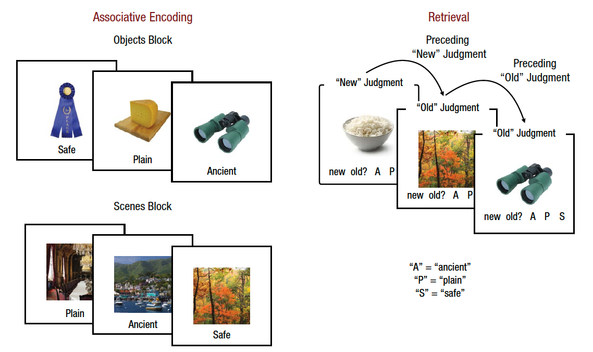

<!--
PSYCH 251 replication report template.

Every project uses this structure so that reports are comparable across the class. They
become public supplementary material, so write for a reader who has the original paper but
not your repository.

The project has two phases, and so does this report:
  Phase 1, the replication. Introduction and Methods are written, critiqued and preregistered
           BEFORE data collection; the Methods addendum, Results and Discussion after it.
  Phase 2, the extension. Proposed after Phase 1 (Rationale, Changes from Phase 1, Power and
           sample, Analysis plan), then run, with its own Results and Discussion.
The AI use statement and the Key statistics table sit at the top and are kept current
throughout. Follow the Extension guidelines page on Canvas for Phase 2.

Render this file at every stage. Before a phase has data, its results say so and skip
themselves; during Pilot A the Phase 1 results run on pilot data, which is the point of Pilot A.

Grey "Guidance" boxes are instructions. Delete each one once you have written that section.
The code is wired to the template's demo experiment (the framing problem). Replace the demo
specifics with your study's as you go: the experiment ids, the original study's numbers, the
exclusion rule, and the key comparison.
-->

```{r}
#| label: setup
#| include: false
library(tidyverse)
library(jsonlite)

# Must match EXPERIMENT.id in experiment.js, and the --experiment you passed to the export.
# Phase 2 runs under its own id, so its data never mix with Phase 1's.
experiment_id        <- "patil2018-pilot-a"
experiment_id_phase2 <- "patil2018-phase2"
```

```{r}
#| label: original-study
#| include: false
# The original study's numbers, entered once and used by the power analysis, the Key
# statistics table, and the side-by-side figures. Replace these with your original study's
# values, and say in a comment exactly where in the paper each one comes from.
#
# Patil & Duncan (2018), Experiment 1, N = 32 analysed (Method, Participants, p. 46).
# Key comparison (Results, p. 48): corrected associative-memory accuracy was 8.23 percentage
# points higher after an "old" than after a "new" judgment on the preceding trial, 95% CI
# [4.10, 12.36], F(1, 31) = 13.88, p = .001, partial eta squared = .31.
# Item memory (Results, p. 49): no effect of the preceding judgment on d',
# F(1, 31) = 0.02, p > .250, partial eta squared < .01.
original_n <- 32
original <- tibble(N = original_n, estimate = 0.0823, ci_low = 0.0410, ci_high = 0.1236,
                   F = 13.88, df = original_n - 1, p = 0.001, pes = 0.31)
original_dprime <- tibble(N = original_n, F = 0.02, df = original_n - 1, p = NA_real_, pes = NA_real_)

# Standardized paired effect implied by the reported F: with one numerator df,
# F = t^2 and d_z = t / sqrt(N). (The reported CI implies a slightly larger t, about 4.1;
# the F is used because it is the test the paper reports.)
original_dz <- sqrt(original$F) / sqrt(original_n)
# SD of the per-participant difference implied by the reported CI, for precision planning.
original_sd_diff <- (original$ci_high - original$ci_low) / 2 / qt(0.975, original_n - 1) * sqrt(original_n)
```

::: {.callout-note appearance="simple" icon=false}
## Project links

- **Original paper:** Patil, A., Duncan, K. (2018). Lingering Cognitive States Shape Fundamental Mnemonic Abilities. *Psychological Science, 29*(1), 45–55 <https://doi.org/10.1177/0956797617728592>
- **Preregistration:** [OSF registration](https://osf.io/XXXXX) *(registered YYYY-MM-DD, before final data collection)*
- **Live experiment:** <https://psych251.github.io/patil2018/> (take the study exactly as participants did)
- **Repository:** <https://github.com/psych251/patil2018> (experiment code, data, and this report)
:::

# AI use statement

I will use Claude Code to help with coding the experiments and for revision of analysis code. 

::: {.callout-tip icon=false}

**Course policy: you write all of the text in this report yourself.** AI tools may help with
code, and may comment on drafts you have written, but they may not write, rewrite or paraphrase
any of the report's text. That includes "polishing" a paragraph.

List every AI tool you used on this project, what you used it for, and how you checked what it
produced. Include coding assistants (for example Claude Code, Codex, Copilot) and chat
assistants. Name the model and version where you know it. "How you checked" is the important
column: say what you verified yourself, not that the output "looked right". If you used no AI
tools, replace the table with a sentence saying so.
:::

| Tool and model | What it was used for | How you checked the output |
|---|---|---|
| *e.g., Claude Code (Claude Opus 5)* | *Implemented the experiment from the original Methods section* | *Ran the automated tests; took the study myself; compared every screen with the original materials* |
| *e.g., Claude Code (Claude Opus 5)* | *Drafted the analysis code* | *Checked the exclusion counts by hand; confirmed the key test matches the preregistration* |
| *e.g., ChatGPT* | *Comments on my draft of the Introduction (no text generated)* | *Decided which comments to act on and made every change myself; checked any factual claim against the source* |

I wrote all of the text in this report myself. AI tools were not used to write, rewrite or
paraphrase it, and were not used to generate, alter, or impute any participant data. I take full
responsibility for the content of this report, including any errors introduced by AI tools.

# Key statistics

::: {.callout-tip icon=false}
## Guidance

One row per study for the key comparison: the original, your Phase 1 replication, and your
Phase 2 extension. The table fills itself in from the data as each phase is exported, using the
analysis code below (open "Show the analysis code"), which is shared by both phases so they are
analysed identically. Edit that code once, here, to match your design and preregistered
exclusion rule. On the scientific-extension track, the Phase 2 row reports the new comparison:
adapt its code and say so in the caption.
:::

```{r}
#| label: analysis-functions
#| code-summary: "Show the analysis code (shared by Phase 1 and Phase 2)"

# Load one phase's exported data and apply the exclusion rule. Returns NULL if that phase
# has not been exported yet, which is how every section below knows to skip itself.
read_phase <- function(id) {
  dir <- file.path("..", "data", "raw", id)
  if (!all(file.exists(file.path(dir, c("participants.csv", "trials.csv"))))) return(NULL)
  participants <- read_csv(file.path(dir, "participants.csv"), show_col_types = FALSE)
  trials       <- read_csv(file.path(dir, "trials.csv"), show_col_types = FALSE,
                           guess_max = 100000)
  errors_path  <- file.path(dir, "errors.csv")
  errors <- if (file.exists(errors_path)) read_csv(errors_path, show_col_types = FALSE) else tibble()

  complete <- participants |> filter(as.logical(completed) %in% TRUE)

  # Post-study answers (one survey row per participant; the last one counts if repeated).
  post <- trials |>
    filter(task == "post_study") |>
    group_by(participant_id) |> slice_tail(n = 1) |> ungroup() |>
    mutate(resp = map(response, ~ tryCatch(fromJSON(.x), error = function(e) list()))) |>
    transmute(participant_id,
              drowsiness          = map_chr(resp, ~ as.character(.x$drowsiness %||% NA)),
              prior_participation = map_chr(resp, ~ as.character(.x$prior_participation %||% NA)))

  # Missed responses (retrieval trials with no key press within 2 s), reported, not excluded on.
  missed <- trials |>
    filter(task == "retrieval") |>
    group_by(participant_id) |>
    summarise(n_retrieval = n(), missed_rate = mean(as.logical(timed_out) %in% TRUE),
              .groups = "drop")

  # Exclusion rule (preregistered; the paper's Experiment 1 rule): exclude participants who
  # report having taken part in a study with the same picture-word task, or who report
  # feeling drowsy throughout most of the study.
  checked <- complete |>
    select(-any_of(c("drowsiness", "prior_participation", "n_retrieval", "missed_rate"))) |>
    left_join(post, by = "participant_id") |>
    left_join(missed, by = "participant_id") |>
    mutate(excl_prior   = prior_participation %in% "Yes",
           excl_drowsy  = drowsiness %in% "Throughout most of the study",
           excluded     = excl_prior | excl_drowsy)
  keep <- checked |> filter(!excluded)

  list(participants = participants, trials = trials, errors = errors,
       complete = complete, checked = checked, keep = keep)
}

# Retrieval trials that enter the analysis, following the paper's Data analysis section:
# analysed participants only; trials with a response; trials with a preceding judgment in the
# same block (the first trial of each block, and trials after a missed response, have none);
# and not trials whose correct word is the response given on the preceding trial (removed to
# reduce response priming). `priming_correction = FALSE` skips that last step (sensitivity check).
retrieval_trials <- function(d, priming_correction = TRUE) {
  steps <- list()
  r <- d$trials |>
    filter(task == "retrieval") |>
    mutate(across(any_of(c("is_old", "timed_out", "prev_is_old")), as.logical),
           across(any_of(c("rt", "prev_rt")), as.numeric))
  steps[["Retrieval trials, analysed participants"]] <- r <- r |> filter(participant_id %in% d$keep$participant_id)
  steps[["Responded within 2 s"]]                    <- r <- r |> filter(!timed_out, !is.na(judgment))
  steps[["Preceding judgment available"]]            <- r <- r |> filter(!is.na(prev_judgment))
  if (priming_correction) {
    steps[["Correct word differs from preceding response"]] <- r <- r |>
      filter(!(coalesce(studied_word == prev_response_label, FALSE)))
  }
  r <- r |> mutate(prev_judgment = factor(prev_judgment, levels = c("new", "old")),
                   category      = factor(category, levels = c("object", "scene")))
  attr(r, "steps") <- tibble(Step = names(steps), Trials = map_int(steps, nrow))
  r
}

# Corrected associative-memory accuracy per participant x preceding judgment x category:
# p(associative hit) - p(associative false alarm) / 2, over old images judged old. A hit is the
# studied word; a false alarm is one of the other two words; "old, can't recall the word" (skip)
# is neither but stays in the denominator. Chance (random word on every trial) is 0.
assoc_by_prev <- function(r) {
  words <- c("ancient", "plain", "safe")
  r |>
    filter(is_old, judgment == "old") |>
    group_by(participant_id, prev_judgment, category, .drop = FALSE) |>
    summarise(n_trials = n(),
              hits = sum(response_label == studied_word),
              fas  = sum(response_label %in% words & response_label != studied_word),
              .groups = "drop") |>
    mutate(value = if_else(n_trials > 0, hits / n_trials - (fas / n_trials) / 2, NA_real_))
}

# Item memory, d' = z(hit rate) - z(false-alarm rate), per participant x preceding judgment x
# category, on trials without a correct association: old images that were not given the right
# word (missed, skipped, or wrong word) and all new images. Log-linear correction (add 0.5 to
# each count and 1 to each denominator; Hautus, 1995) so rates of 0 or 1 stay finite.
dprime_by_prev <- function(r) {
  r |>
    filter(!(is_old & judgment == "old" & coalesce(response_label == studied_word, FALSE))) |>
    group_by(participant_id, prev_judgment, category, .drop = FALSE) |>
    summarise(n_old = sum(is_old),  hits = sum(is_old & judgment == "old"),
              n_new = sum(!is_old), fas  = sum(!is_old & judgment == "old"),
              .groups = "drop") |>
    mutate(value = if_else(n_old > 0 & n_new > 0,
                           qnorm((hits + 0.5) / (n_old + 1)) - qnorm((fas + 0.5) / (n_new + 1)),
                           NA_real_))
}

# Median RT on trials where the association was correct (the paper's RT analysis).
rt_by_prev <- function(r) {
  r |>
    filter(is_old, judgment == "old", response_label == studied_word, !is.na(rt)) |>
    group_by(participant_id, prev_judgment, category, .drop = FALSE) |>
    summarise(n_trials = n(), value = if (n() > 0) mean(rt) else NA_real_, .groups = "drop")
}

# Participants with a value in all four cells: the 2 x 2 repeated-measures ANOVA needs them.
complete_cells <- function(cells) {
  cells |>
    group_by(participant_id) |>
    filter(sum(!is.na(value)) == 4) |>
    ungroup()
}

# 2 (preceding judgment) x 2 (category) repeated-measures ANOVA. NULL until at least
# three participants have all four cells.
rm_anova <- function(cells) {
  cc <- complete_cells(cells)
  if (n_distinct(cc$participant_id) < 3) return(NULL)
  fit <- afex::aov_ez(id = "participant_id", dv = "value", data = cc,
                      within = c("prev_judgment", "category"),
                      anova_table = list(es = "pes", correction = "none"))
  tab <- as.data.frame(fit$anova_table)
  tibble(Effect = c("Preceding judgment", "Category", "Preceding judgment x category"),
         df1 = tab$`num Df`, df2 = tab$`den Df`, F = tab$F, pes = tab$pes, p = tab$`Pr(>F)`)
}

# The key statistic: mean difference (preceding "old" minus preceding "new"), averaging the
# two categories within each participant, with a paired-t 95% CI. Its F(1, N - 1) = t^2 is the
# ANOVA's main effect of preceding judgment. NULL until two participants have all four cells.
diff_ci <- function(cells) {
  per_pp <- complete_cells(cells) |>
    group_by(participant_id, prev_judgment) |>
    summarise(value = mean(value), .groups = "drop") |>
    pivot_wider(names_from = prev_judgment, values_from = value) |>
    mutate(diff = old - new)
  if (nrow(per_pp) < 2 || sd(per_pp$diff) == 0) return(NULL)
  tt <- t.test(per_pp$diff)
  F <- unname(tt$statistic)^2
  df <- unname(tt$parameter)
  tibble(N = nrow(per_pp), estimate = mean(per_pp$diff),
         ci_low = tt$conf.int[1], ci_high = tt$conf.int[2],
         F = F, df = df, p = tt$p.value, pes = F / (F + df), sd_diff = sd(per_pp$diff))
}

# The key comparison for one phase: associative accuracy after "old" vs "new" judgments.
key_effect <- function(d) diff_ci(assoc_by_prev(retrieval_trials(d)))

# Side-by-side figure of the key effect: any number of studies on the same axes, in the order
# given. Each argument is a one-row tibble from diff_ci() (or `original`); NULLs are dropped.
comparison_plot <- function(...) {
  studies <- list(...)
  studies <- studies[!map_lgl(studies, ~ is.null(.x) || nrow(.x) == 0)]
  df <- imap_dfr(studies, ~ mutate(select(.x, N, estimate, ci_low, ci_high), Study = .y)) |>
    mutate(Study = factor(Study, levels = names(studies)), label = sprintf("N = %d", N))
  cols <- setNames(c("grey45", "#1E6E76", "#B8792A")[seq_along(studies)], names(studies))
  ggplot(df, aes(x = Study, y = 100 * estimate, colour = Study)) +
    geom_hline(yintercept = 0, colour = "grey60") +
    geom_errorbar(aes(ymin = 100 * ci_low, ymax = 100 * ci_high), width = 0.15, linewidth = 0.8) +
    geom_point(size = 3) +
    geom_text(aes(y = 100 * ci_high, label = label), vjust = -0.8, size = 3, colour = "grey30") +
    scale_colour_manual(values = cols, guide = "none") +
    labs(x = NULL, y = "Associative accuracy:\npreceding \"old\" minus \"new\" (points)") +
    theme_minimal(base_size = 12)
}

# Cell means by preceding judgment and category, with within-participant 95% CIs
# (Cousineau-Morey), the layout of the paper's Figure 2. Takes named cell tables (one panel
# each, e.g. `Associative accuracy = assoc`); participants with all four cells only.
cell_plot <- function(...) {
  morey <- 4 / 3   # M / (M - 1) for M = 4 within-participant cells
  df <- imap_dfr(list(...), function(cells, measure) {
    cc <- complete_cells(cells)
    if (n_distinct(cc$participant_id) < 2) return(NULL)
    cc |>
      group_by(participant_id) |> mutate(norm = value - mean(value) + mean(cc$value)) |> ungroup() |>
      group_by(prev_judgment, category) |>
      summarise(n = n(), mean = mean(value), se = sqrt(morey) * sd(norm) / sqrt(n), .groups = "drop") |>
      mutate(half = qt(0.975, n - 1) * se, measure = measure)
  })
  if (nrow(df) == 0) return(NULL)
  df$measure <- factor(df$measure, levels = names(list(...)))
  ggplot(df, aes(x = prev_judgment, y = mean, fill = category)) +
    geom_col(position = position_dodge(0.8), width = 0.75) +
    geom_errorbar(aes(ymin = mean - half, ymax = mean + half), position = position_dodge(0.8), width = 0.2) +
    facet_wrap(~ measure, scales = "free_y") +
    scale_fill_manual(values = c(object = "#1E6E76", scene = "#B8792A")) +
    labs(x = "Preceding judgment", y = NULL, fill = NULL) +
    theme_minimal(base_size = 12) +
    theme(legend.position = "top")
}

fmt_p <- function(p) if (is.na(p)) "" else format.pval(p, digits = 2, eps = 0.001)

phase1 <- read_phase(experiment_id)
phase2 <- read_phase(experiment_id_phase2)
have_data   <- !is.null(phase1)
have_phase2 <- !is.null(phase2)
```

```{r}
#| label: key-stats
#| echo: false
fmt_row <- function(study, r) {
  if (is.null(r)) {
    return(tibble(Study = study, N = "", `Effect (old − new)` = "not yet collected",
                  `95% CI` = "", F = "", p = "", `ηp²` = ""))
  }
  tibble(Study = study, N = as.character(r$N),
         `Effect (old − new)` = sprintf("%.2f points", 100 * r$estimate),
         `95% CI` = sprintf("[%.2f, %.2f]", 100 * r$ci_low, 100 * r$ci_high),
         F = sprintf("F(1, %d) = %.2f", as.integer(r$df), r$F),
         p = fmt_p(r$p),
         `ηp²` = sprintf("%.2f", r$pes))
}
bind_rows(
  fmt_row("Original", original),
  fmt_row("Phase 1: replication", if (have_data) key_effect(phase1)),
  fmt_row("Phase 2: extension", if (have_phase2) key_effect(phase2))
) |>
  knitr::kable(align = "lrlllrr",
               caption = "Key comparison: corrected associative-memory accuracy after an \"old\" judgment minus after a \"new\" judgment on the preceding trial, in percentage points (main effect of preceding judgment in the 2 × 2 repeated-measures ANOVA).")
```

# Phase 1: Replication

## Introduction

### Justification

In this paper, Patil and Duncan found that recent exposure to familiarity selectively improved associative memory (Experiment 1), and that this effect decayed over seconds (Experiment 2). During my PhD, I plan to study the development of different memory subprocesses, including pattern completion and separation, so this paper will help me better understand how these processes are studied in adults, as well as how this type of data is analyzed, for example, using a Signal Detection Theory framework to assess memory accuracy.

### Procedure and Challenges

This replication involved creating two online experiments using the same stimuli from the original paper, which the authors made available on the Open Science Framework. The stimuli consisted of 484 images on a white background. Unlike the original study, I collected data online through Prolific. One challenge I faced was obtaining quality data from an online sample, which required implementing features that prevented bots from completing the task.

### Statistical tests

Separate 2 (preceding judgment: old vs. new) × 2 (stimulus: object vs. scene) repeated measures analyses of variance (ANOVAs) were used to analyze corrected
associative-memory accuracy, response time on trials on which associative memory was correct, and d′.Paired-samples t tests (two-tailed) were used to examine
simple effects. For pairwise comparisons, t tests were conducted with Bonferroni correction. Two generalized mixed-effects models were estimated with an
unstructured covariance matrix to control for response time on the preceding trial and preceding trial type, respectively.

### Extension

A possible extension is to add more trials and have a larger sample size. 

## Methods

### Power analysis

::: {.callout-tip icon=false}
## Guidance

Report the original effect size, the sample needed for 80%, 90% and 95% power to detect it,
and the sample you chose and why. The table below is computed from the original study's
numbers entered at the top of this file.

Original effects are usually overestimates, so powering to the original effect tends to
produce an underpowered replication. One widely used alternative is to collect 2.5 times the
original sample, which gives 80% power to detect an effect the original study had only 33%
power to detect (Simonsohn, 2015; Experimentology §10.4). Say which approach you used, and
what the course's participant budget allowed.
:::

```{r}
#| label: power
# Within-participant design: the key test is a paired comparison (equivalently the 1-df main
# effect in the repeated-measures ANOVA), so power is for a paired t test at the original d_z.
power_rows <- map_dfr(c(0.80, 0.90, 0.95), function(pw) {
  n <- power.t.test(delta = original_dz, sd = 1, power = pw, sig.level = 0.05,
                    type = "paired")$n
  tibble(power = scales::percent(pw), n_total = ceiling(n))
})

two_and_half <- ceiling(2.5 * original_n)

knitr::kable(power_rows, col.names = c("Power", "N participants"),
             caption = sprintf(
               "Sample needed to detect the original effect (associative accuracy %.2f points higher after \"old\" than after \"new\" judgments; d_z = %.2f, from F(1, %d) = %.2f), paired, two-sided alpha = .05.",
               100 * original$estimate, original_dz, original$df, original$F))
```

For comparison, 2.5 times the original sample would be `r two_and_half[1]` in the gain frame
and `r two_and_half[2]` in the loss frame (`r sum(two_and_half)` in total).

### Planned sample

::: {.callout-tip icon=false}
## Guidance

Planned sample size and stopping rule, sampling frame (for example, "US residents on Prolific,
fluent in English, 18 or older"), known demographics, and any preselection or screening. The
stopping rule should be data-independent: "collect until N participants pass the exclusion
criteria below" rather than "until the result is clear".
:::

### Materials

::: {.callout-tip icon=false}
## Guidance

All materials. You can quote the original article directly: put the text in quotation marks
and note that it was followed precisely, or quote it and point out the exceptions. Link to the
live experiment above rather than pasting screenshots of every screen.
:::

### Procedure

::: {.callout-tip icon=false}
## Guidance

As for Materials: quote the original where you can and point out the exceptions. Describe the
sequence a participant experiences, from consent to debrief, and how long it takes.
:::

### Analysis plan

::: {.callout-tip icon=false}
## Guidance

The analysis strategy, as close to the original as possible: data cleaning rules, exclusion
rules, covariates, and the model or test. Original papers often do not spell this out; say
where you had to make a choice and what you chose.

**State the key analysis of interest explicitly.** That is the single test your replication
stands or falls on, and it must match your preregistration. You can pre-specify additional
analyses here too.
:::

**Key analysis of interest.** The proportion of participants choosing the risky program is
higher in the loss frame than in the gain frame, tested with a chi-square test of independence
on the 2 × 2 table of frame by choice. The effect size is the difference in the proportion
choosing the risky program (loss minus gain), with a 95% confidence interval.

**Exclusions.** Participants are excluded if they did not complete the study, if they answered
no speeded trial at all (every lexical-decision trial timed out, the signature of a device
without a keyboard), or if they answered fewer than 6 of the 8 lexical-decision trials
correctly.

### Differences from the original study

::: {.callout-tip icon=false}
## Guidance

Every known difference in sample, setting, procedure, materials, and analysis, one per row.
Minimizing differences is the goal, but some always remain. For each one, say whether it is
expected to matter, based on claims in the original article or later research on when the
effect does and does not appear. The rows below are the demo's real differences and show the
level of detail expected; replace them with yours.
:::

| Aspect | Original study | This replication | Expected to matter? |
|---|---|---|---|
| Sample | University students in Stanford and British Columbia classrooms | Adults recruited on Prolific | Possibly. Framing effects have been found in both student and general samples, but their size varies across populations. |
| Setting | Paper questionnaire in class | Online, unsupervised, on the participant's own computer | Unlikely for a single vignette, though attention may be lower online. |
| Wording | "an unusual Asian disease" | "an unusual disease" | Unlikely. The ethnonym is incidental to the manipulation and dated. |
| Design | Between subjects: each participant saw one frame | Between subjects, randomly assigned | No. |
| Response | Circle a program on paper | Click a button | Unlikely. |
| Other tasks | Problems presented alongside other questionnaire items | Followed by a short lexical-decision task used as an attention check | Unlikely: the check comes after the choice. |

### Methods addendum (post data collection)

::: {.callout-tip icon=false}
## Guidance

Leave this section out of the version you preregister. After data collection, report the
actual sample and any deviation from the plan above.
:::

#### Actual sample

```{r}
#| label: no-data-notice
#| echo: false
#| results: asis
if (!have_data) {
  cat(
    "::: {.callout-warning icon=false}\n",
    "## No Phase 1 data yet\n\n",
    "There are no exported data for `", experiment_id, "` yet, so the sample and results ",
    "sections are skipped. This is expected before data collection. Export with ",
    "`npm run export -- --experiment ", experiment_id, " --key <path to your key>` and render again. ",
    "If you have exported, check that `experiment_id` at the top of this file matches ",
    "`EXPERIMENT.id` in `experiment.js`.\n",
    ":::\n", sep = "")
}
```

```{r}
#| label: phase1-data
#| eval: !expr have_data

# Loaded and excluded by read_phase(), under Key statistics, so Phase 1 and Phase 2 share one
# exclusion rule.
participants <- phase1$participants
trials       <- phase1$trials
errors       <- phase1$errors
complete     <- phase1$complete
checked      <- phase1$checked
keep         <- phase1$keep
```

```{r}
#| label: funnel
#| eval: !expr have_data

# Split by which category started the encoding session (randomly assigned counterbalancing).
funnel_levels <- c("Started", "Completed", "Passed exclusion criteria")
by_col <- if ("first_encoding_category" %in% names(participants)) "first_encoding_category" else NULL
bind_rows(
  participants |> mutate(step = "Started"),
  complete     |> mutate(step = "Completed"),
  keep         |> mutate(step = "Passed exclusion criteria")
) |>
  mutate(step = factor(step, levels = funnel_levels),
         group = if (is.null(by_col)) "All" else paste("Encoding started with", coalesce(.data[[by_col]], "unknown"))) |>
  count(step, group, .drop = FALSE) |>
  pivot_wider(names_from = group, values_from = n, values_fill = 0) |>
  mutate(Total = rowSums(across(-step))) |>
  rename(Step = step) |>
  knitr::kable(caption = "Participants at each step, by counterbalancing order (which category was studied first). Differences between orders in attrition or exclusion are a threat to validity and should be discussed.")

checked |>
  summarise(`Completed` = n(),
            `Prior participation ("Yes")` = sum(excl_prior),
            `Drowsy throughout` = sum(excl_drowsy),
            `Excluded (either)` = sum(excluded),
            `Prior participation "Not sure" (kept)` = sum(prior_participation %in% "Not sure"),
            `Post-study answers missing (kept)` = sum(is.na(drowsiness) & is.na(prior_participation))) |>
  pivot_longer(everything(), names_to = "Reason", values_to = "Participants") |>
  knitr::kable(caption = "Exclusions among completed sessions. A participant can meet both criteria.")
```

```{r}
#| label: sample-text
#| eval: !expr have_data
#| echo: false
#| results: asis

cat(sprintf("Of %d participants who started, %d completed the study and %d met the exclusion criteria.",
            nrow(participants), nrow(complete), nrow(keep)))
if (nrow(keep) > 0 && any(!is.na(keep$missed_rate))) {
  cat(sprintf(" Analysed participants missed %.1f%% of retrieval trials on average (range %.1f%% to %.1f%%).",
              100 * mean(keep$missed_rate, na.rm = TRUE), 100 * min(keep$missed_rate, na.rm = TRUE),
              100 * max(keep$missed_rate, na.rm = TRUE)))
}
if (nrow(keep) == 0) cat(" No participants remain for analysis yet, so the results below are empty.")
cat("\n")
```

```{r}
#| label: demographics
#| eval: !expr have_data
demo <- trials |>
  filter(task == "demographics", participant_id %in% keep$participant_id) |>
  mutate(resp = map(response, ~ fromJSON(.x))) |>
  transmute(
    participant_id,
    age    = map_dbl(resp, ~ as.numeric(.x$age %||% NA)),
    gender = map_chr(resp, ~ as.character(.x$gender %||% NA))
  )

if (nrow(demo) > 0) {
  demo |>
    summarise(N = n(), `Mean age` = round(mean(age, na.rm = TRUE), 1),
              `SD age` = round(sd(age, na.rm = TRUE), 1),
              `Age not given` = sum(is.na(age))) |>
    knitr::kable(caption = "Age of the analysed sample.")
}
```

#### Deviations from the preregistered plan

::: {.callout-tip icon=false}
## Guidance

Any deviation from the preregistered plan above, or "None". Changes made after seeing data
belong here even if they seem minor, together with the reason.
:::

## Results

### Data preparation

::: {.callout-tip icon=false}
## Guidance

Data preparation follows the analysis plan. Loading and exclusions are done by the shared
analysis code under Key statistics (open "Show the analysis code"). Describe anything you did to
the data beyond that.
:::

```{r}
#| label: data-prep
#| eval: !expr have_data
retr <- retrieval_trials(phase1)
attr(retr, "steps") |>
  knitr::kable(caption = "Retrieval trials at each step of trial-level data preparation (analysed participants).")

assoc  <- assoc_by_prev(retr)
dprime <- dprime_by_prev(retr)
rts    <- rt_by_prev(retr)

# Trials behind each participant's cells: a cell with few trials gives a noisy estimate.
assoc |>
  group_by(`Preceding judgment` = prev_judgment, Category = category) |>
  summarise(`Participants with trials` = sum(n_trials > 0),
            `Median trials per participant` = median(n_trials),
            `Min trials` = min(n_trials), .groups = "drop") |>
  knitr::kable(caption = "Old images judged old (the trials behind corrected associative accuracy), per cell.")

n_missing_cells <- tibble(
  Measure = c("Associative accuracy", "d′", "RT (correct associations)"),
  `Participants with all four cells` = c(n_distinct(complete_cells(assoc)$participant_id),
                                         n_distinct(complete_cells(dprime)$participant_id),
                                         n_distinct(complete_cells(rts)$participant_id)),
  `Analysed participants` = nrow(keep))
knitr::kable(n_missing_cells, caption = "Participants entering each repeated-measures ANOVA (all four cells required).")
```

### Confirmatory analysis

```{r}
#| label: confirmatory
#| eval: !expr have_data

fmt_anova <- function(tab, measure) {
  if (is.null(tab)) {
    message(measure, ": ANOVA not run yet (needs at least 3 participants with all four cells).")
    return(invisible(NULL))
  }
  tab |>
    transmute(Effect, F = sprintf("F(%d, %d) = %.2f", as.integer(df1), as.integer(df2), F),
              p = map_chr(p, fmt_p), `ηp²` = sprintf("%.2f", pes)) |>
    knitr::kable(caption = sprintf("%s: 2 (preceding judgment) × 2 (category) repeated-measures ANOVA.", measure))
}

# Key analysis: corrected associative-memory accuracy.
fmt_anova(rm_anova(assoc), "Corrected associative-memory accuracy")
rep <- diff_ci(assoc)
if (!is.null(rep)) {
  cat(sprintf("Key comparison, preceding \"old\" minus \"new\": %.2f points, 95%% CI [%.2f, %.2f], F(1, %d) = %.2f, p %s, partial eta squared = %.2f (N = %d).\n",
              100 * rep$estimate, 100 * rep$ci_low, 100 * rep$ci_high, as.integer(rep$df), rep$F,
              if (rep$p < 0.001) "< .001" else sprintf("= %.3f", rep$p), rep$pes, rep$N))
}

# Item memory (d'), where the original found no effect of the preceding judgment.
fmt_anova(rm_anova(dprime), "Item memory (d′)")

# Response time on trials with a correct association.
fmt_anova(rm_anova(rts), "Response time on correct-association trials (ms)")
```

### Replication assessment

::: {.callout-tip icon=false}
## Guidance

Judge the replication on effect sizes, not only on whether the key test is significant. Compare
the replication estimate and its interval with the original: does the interval exclude zero, and
does it include the original estimate? A significant result much smaller than the original, or
a non-significant result whose interval still includes the original effect, are both
informative and should be reported as such (Experimentology §3.2).
:::

```{r}
#| label: comparison
#| eval: !expr have_data

orig <- original

if (!is.null(rep)) {
  bind_rows(orig |> mutate(Study = "Original"), rep |> mutate(Study = "Phase 1: replication")) |>
    transmute(Study, N,
              `Difference (old − new)` = sprintf("%.2f points", 100 * estimate),
              `95% CI` = sprintf("[%.2f, %.2f]", 100 * ci_low, 100 * ci_high),
              `ηp²` = sprintf("%.2f", pes),
              p = map_chr(p, fmt_p)) |>
    knitr::kable(caption = "Effect size: corrected associative-memory accuracy after a preceding \"old\" minus a preceding \"new\" judgment, in percentage points.")
} else {
  message("Replication effect size not computed yet: need at least two analysed participants with all four cells.")
}
```

```{r}
#| label: comparison-verdict
#| eval: !expr have_data
#| echo: false
#| results: asis

if (!is.null(rep)) {
  excludes_zero <- rep$ci_low > 0 | rep$ci_high < 0
  includes_orig <- orig$estimate >= rep$ci_low & orig$estimate <= rep$ci_high
  cat(sprintf(
    "The replication's 95%% interval %s zero and %s the original estimate of %.2f points. ",
    if (excludes_zero) "excludes" else "includes",
    if (includes_orig) "includes" else "does not include",
    100 * orig$estimate))
  cat("These two facts are the starting point for the summary in the Discussion, not the conclusion.\n")
}
```

::: {.callout-tip icon=false}
## Guidance: show the original next to your replication

**Every report should have a figure that puts the original finding and your replication side by
side.** It is the single most informative thing in a replication report: a reader can see at a
glance whether the effect came back, and how its size compares. Make it however you can, in
roughly this order of preference:

1. **Replot both from numbers.** Enter the original's summary statistics (means or proportions,
   with SDs, SEs or CIs, and Ns) in the original-study chunk at the top of this file, and plot
   them on the same axes as yours. That is what the demo figure below does.
2. **Replot the original from its data**, if the authors shared it or it is in an open
   repository, using exactly the same plotting code as for your own data.
3. **Show the original figure as an image** next to yours if neither is possible. Save a
   screenshot of it, for example as `writeup/images/original-figure.png`, and lay the two out
   in columns:

   ````markdown
   ::: {layout-ncol=2}
   

   ```{{r}}
   # your replication plot here
   ```
   :::
   ````

Whichever you choose, use the same measure, scale, condition order and error-bar meaning for
both panels, label which is which, and cite the source of the original values or figure in the
caption. If the original reported no variability, say so rather than leaving it out silently.
:::

```{r}
#| label: fig-comparison
#| eval: !expr have_data
#| fig-cap: "Key effect: corrected associative-memory accuracy after a preceding \"old\" minus a preceding \"new\" judgment, original study (Patil & Duncan, 2018, Experiment 1, p. 48) and Phase 1 replication. Error bars are 95% confidence intervals (paired t)."
#| fig-width: 6
#| fig-height: 4

comparison_plot(Original = original, `Phase 1: replication` = rep)
```

```{r}
#| label: fig-cells
#| eval: !expr have_data
#| fig-cap: "Phase 1 cell means by preceding judgment and category: corrected associative-memory accuracy (left) and d′ on trials without a correct association (right). Error bars are within-participant 95% confidence intervals (Cousineau-Morey); participants with all four cells only."
#| fig-width: 8
#| fig-height: 4
cell_plot(`Corrected associative-memory accuracy` = assoc, `d′ (item memory)` = dprime)
```

### Exploratory analyses

::: {.callout-tip icon=false}
## Guidance

Any follow-up analyses (optional). Label them clearly as exploratory: they were not planned, so
they generate hypotheses rather than test them.
:::

```{r}
#| label: exploratory-rt
#| eval: !expr have_data

# Exploratory checks reported in the original's Supplemental Material:
# (1) the key effect without removing trials whose correct word matched the preceding response;
# (2) the key effect split by the preceding image's objective status (old vs new image) rather
#     than the participant's judgment of it.
no_priming <- diff_ci(assoc_by_prev(retrieval_trials(phase1, priming_correction = FALSE)))
by_type <- retr |>
  filter(!is.na(prev_is_old)) |>
  mutate(prev_judgment = factor(if_else(prev_is_old, "old", "new"), levels = c("new", "old"))) |>
  assoc_by_prev() |>
  diff_ci()

list(`Preregistered (priming correction)` = rep,
     `Without priming correction` = no_priming,
     `Preceding image objectively old vs new` = by_type) |>
  discard(is.null) |>
  imap_dfr(~ mutate(.x, Analysis = .y)) |>
  (\(t) if (nrow(t) == 0) {
    message("Exploratory effects not computed yet: need at least two analysed participants with all four cells.")
  } else {
    t |>
      transmute(Analysis, N,
                `Difference (old − new)` = sprintf("%.2f points", 100 * estimate),
                `95% CI` = sprintf("[%.2f, %.2f]", 100 * ci_low, 100 * ci_high),
                p = map_chr(p, fmt_p)) |>
      knitr::kable(caption = "Exploratory: the key associative-memory effect under alternative trial selections.")
  })()

keep |>
  filter(!is.na(missed_rate)) |>
  summarise(Participants = n(), `Mean missed (%)` = round(100 * mean(missed_rate), 1),
            `SD (%)` = round(100 * sd(missed_rate), 1), `Max (%)` = round(100 * max(missed_rate), 1),
            `Above mean + 4 SD` = sum(missed_rate > mean(missed_rate) + 4 * sd(missed_rate), na.rm = TRUE)) |>
  knitr::kable(caption = "Exploratory: missed retrieval responses per analysed participant (not an exclusion criterion here; the original used > 4 SD above the mean in Experiment 2).")
```

```{r}
#| label: data-quality
#| eval: !expr have_data
if (nrow(errors) > 0) {
  errors |> select(any_of(c("at", "trial_index", "message"))) |> head(20) |>
    knitr::kable(caption = "JavaScript errors reported from participants' browsers.")
} else {
  message("No errors were reported from participants' browsers.")
}
```

## Discussion

### Summary of replication attempt

::: {.callout-tip icon=false}
## Guidance

Open with one paragraph summarizing the result of the key analysis and your assessment of
whether the original finding replicated, partially replicated, or failed to replicate. Base
that judgment on the replication assessment above: the size of the effect relative to the
original, not just the p value.
:::

### Commentary

::: {.callout-tip icon=false}
## Guidance

Open-ended commentary, none of it long: (a) what the exploratory analyses suggest; (b) what the
replication means, for example whether the differences between your study and the original are
definitely, plausibly, or unlikely to be moderators of the result; and (c) any objections or
challenges raised by you or the original authors.
:::

# Phase 2: Extension

::: {.callout-tip icon=false}
## Guidance: choosing your extension

Follow the Extension guidelines page on Canvas. In brief:

- **By default the extension is a best-practices modification of your Phase 1 experiment.** If
  your replication did not succeed, it is a **rescue**: address the plausible reasons for the
  failure. If it did succeed, it is an **upgrade**: make the estimate more precise. Typical
  changes are better or more reliable measurement, more trials, a within-participant design
  where that is legitimate, comprehension and manipulation checks, clearer instructions, or a
  larger or better-targeted sample.
- **If your scientific extension pitch was approved at Milestone 3 and your replication
  succeeded, propose that instead:** the original conditions rerun unchanged, plus the one
  added condition or manipulation, with a power analysis for the new comparison.
- On either track you may add exploratory measures **at the end** of the study.
- Every change is listed and tagged by category below; everything else stays identical.

State your track on the line below, and delete the others.
:::

**Track:** Best-practices upgrade / Best-practices rescue / Scientific extension (approved at Milestone 3)

## Rationale

::: {.callout-tip icon=false}
## Guidance

One or two paragraphs. For a rescue: what are the plausible reasons Phase 1 did not reproduce the
original result, and how does each change address one of them? For an upgrade: where is the
Phase 1 estimate least precise or least trustworthy, and how will the changes improve it? For a
scientific extension: what question does the added condition answer, and why does it follow from
the original finding?
:::

## Changes from Phase 1

::: {.callout-tip icon=false}
## Guidance

Every change from the Phase 1 experiment, one per row, each tagged with a category: Measurement,
Trials, Design, Checks, Instructions, Sample, Added condition (scientific track only), or
Exploratory measure (end of study only). If it is not in this table, it does not change: same
materials, wording, procedure, exclusion rule and analysis. The rows below are examples for the
demo; replace them with yours.
:::

| # | Category | Phase 1 | Phase 2 | Why |
|---|---|---|---|---|
| 1 | Sample | 27 analysed participants | 300 analysed participants (150 per frame) | Phase 1's interval was too wide to distinguish the original effect from a much smaller one. |
| 2 | Checks | No comprehension check | After the choice, participants say how many people are at risk (600) | Confirms participants read the scenario; failures are reported, and excluded only if preregistered. |
| 3 | Exploratory measure | None | At the end: "How confident are you in your choice?" (1–7) | Exploratory only; collected after every confirmatory measure. |

Everything not listed above is identical to Phase 1.

## Power and sample

::: {.callout-tip icon=false}
## Guidance

Justify the Phase 2 sample, and **state how you expect the estimate and its precision to compare
with Phase 1**. For an upgrade, plan the sample around the confidence interval you want; for a
rescue, around the power to detect the original effect, or the smallest effect you would still
consider a successful replication; for a scientific extension, around the power to detect the new
comparison. Set `phase2_n_per_group` in the code below; the table uses Phase 1's estimate if you
have it and the original's otherwise.
:::

```{r}
#| label: phase2-power

phase2_n <- 80   # planned analysed participants in Phase 2 (placeholder: 2.5 x the original 32)

p1_stats <- if (have_data) key_effect(phase1)
basis <- if (!is.null(p1_stats)) {
  list(dz = p1_stats$estimate / p1_stats$sd_diff, sd_diff = p1_stats$sd_diff, source = "Phase 1")
} else {
  list(dz = original_dz, sd_diff = original_sd_diff, source = "the original study")
}

# Expected 95% CI half-width on the paired difference with n participants.
half_width <- function(n) qt(0.975, n - 1) * basis$sd_diff / sqrt(n)
power_at <- function(n, dz) {
  tryCatch(power.t.test(n = n, delta = dz, sd = 1, sig.level = 0.05, type = "paired")$power,
           error = function(e) NA)
}

rows <- tibble(
  Study = c(if (!is.null(p1_stats)) "Phase 1 (actual)", "Phase 2 (planned)"),
  `N analysed` = c(if (!is.null(p1_stats)) p1_stats$N, phase2_n),
  `95% CI half-width` = c(if (!is.null(p1_stats)) sprintf("±%.2f points", 100 * (p1_stats$ci_high - p1_stats$ci_low) / 2),
                          sprintf("±%.2f points (expected)", 100 * half_width(phase2_n)))
)
knitr::kable(rows, caption = sprintf("Precision of the key estimate, Phase 2 expected values based on the SD of the difference in %s.", basis$source))

tibble(
  `Effect to detect` = c(sprintf("Original: %.2f points (d_z = %.2f)", 100 * original$estimate, original_dz),
                         if (!is.null(p1_stats)) sprintf("Phase 1: %.2f points (d_z = %.2f)", 100 * p1_stats$estimate, basis$dz),
                         sprintf("Half the original: %.2f points (d_z = %.2f)", 50 * original$estimate, original_dz / 2)),
  `Power at planned N` = scales::percent(c(
    power_at(phase2_n, original_dz),
    if (!is.null(p1_stats)) power_at(phase2_n, basis$dz),
    power_at(phase2_n, original_dz / 2)
  ), accuracy = 1)
) |>
  knitr::kable(caption = sprintf("Power of the Phase 2 key test (paired) at N = %d, two-sided alpha = .05.", phase2_n))
```

## Analysis plan

::: {.callout-tip icon=false}
## Guidance

The confirmatory analysis for Phase 2, written before Phase 2 data collection. On the
best-practices tracks this is normally the same key test as Phase 1, run on the Phase 2 data
alone; say whether you will also report a pooled estimate across phases, and label it
exploratory if so. On the scientific track, specify the test for the new comparison. Name the
exclusion rule (unchanged unless it is in the Changes table) and list any exploratory measures.

Run Phase 2 under a new `EXPERIMENT.id` in `experiment.js` (for example `smith2016-phase2`) and
set `experiment_id_phase2` at the top of this file to match, so the two phases' data never mix.
:::

## Results

```{r}
#| label: phase2-notice
#| echo: false
#| results: asis
if (!have_phase2) {
  cat(
    "::: {.callout-warning icon=false}\n",
    "## No Phase 2 data yet\n\n",
    "There are no exported data for `", experiment_id_phase2, "` yet, so the Phase 2 results are ",
    "skipped. Export with `npm run export -- --experiment ", experiment_id_phase2,
    " --key <path to your key>` once Phase 2 has run.\n",
    ":::\n", sep = "")
}
```

```{r}
#| label: phase2-results
#| eval: !expr have_phase2

p2_retr  <- retrieval_trials(phase2)
p2_assoc <- assoc_by_prev(p2_retr)
p2_stats <- diff_ci(p2_assoc)
cat(sprintf("Phase 2: %d started, %d completed, %d analysed.\n",
            nrow(phase2$participants), nrow(phase2$complete), nrow(phase2$keep)))
if (!is.null(p2_stats)) {
  p_text <- if (p2_stats$p < 0.001) "p < .001" else sprintf("p = %.3f", p2_stats$p)
  cat(sprintf("Key comparison: %.2f points [%.2f, %.2f], F(1, %d) = %.2f, %s, partial eta squared = %.2f (N = %d).\n",
              100 * p2_stats$estimate, 100 * p2_stats$ci_low, 100 * p2_stats$ci_high,
              as.integer(p2_stats$df), p2_stats$F, p_text, p2_stats$pes, p2_stats$N))
}
p2_anova <- rm_anova(p2_assoc)
if (!is.null(p2_anova)) {
  p2_anova |>
    transmute(Effect, F = sprintf("F(%d, %d) = %.2f", as.integer(df1), as.integer(df2), F),
              p = map_chr(p, fmt_p), `ηp²` = sprintf("%.2f", pes)) |>
    knitr::kable(caption = "Phase 2, corrected associative-memory accuracy: 2 (preceding judgment) × 2 (category) repeated-measures ANOVA.")
}
```

```{r}
#| label: fig-phase2
#| eval: !expr have_phase2
#| fig-cap: "Key effect: corrected associative-memory accuracy after a preceding \"old\" minus a preceding \"new\" judgment, original study (Patil & Duncan, 2018, Experiment 1), Phase 1 replication, and Phase 2 extension. Error bars are 95% confidence intervals (paired t)."
#| fig-width: 7
#| fig-height: 4

comparison_plot(Original = original,
                `Phase 1: replication` = if (have_data) key_effect(phase1),
                `Phase 2: extension` = p2_stats)
```

## Discussion

::: {.callout-tip icon=false}
## Guidance

Compare Phase 2 with Phase 1 and with the original, using the Key statistics table and the figure
above. Did the precision improve as you expected? For a rescue, did addressing the plausible
reasons recover the effect? For a scientific extension, what does the new condition show? End
with what the two phases together say about the original finding.
:::

# Data and code availability

::: {.callout-tip icon=false}
## Guidance

Edit the statement below to match what you are actually sharing. Anonymized data and all code
should be public; if something cannot be shared, say what and why.
:::

The experiment code, the anonymized data, and the code that produces every number in this
report are available at <https://github.com/psych251/your-repo>. The experiment itself can be
taken at <https://psych251.github.io/your-repo/>. The data contain no names, email addresses,
IP addresses, or Prolific IDs; the file linking participants to their Prolific IDs is kept
privately for payment and is not shared.
